# S7-1200 真机联调与 TIA 操作手册

> 整理日期：2026-11-24  
> 场景：**CPU 1215C DC/DC/DC**（订货号 `6ES7 215-1AG40-0XB0`）+ **TIA Portal V20** + **超控 byte 读写**  
> 相关代码说明：[S7_byte_改动说明.md](./S7_byte_改动说明.md) · [S7_DB地址与偏移量说明.md](./S7_DB地址与偏移量说明.md)

### 图片与复制说明

- 截图与本文 **同级目录** 下的 **`images/`** 文件夹绑定，文中路径形如 `./images/01-xxx.png`。
- **复制手册时请整包复制**：`S7-1200真机联调与TIA操作手册.md` + **`images/` 文件夹（21 张 png）**，并保持二者在同一目录。
- **Cursor / VS Code 预览仍不显示时**：
  1. 用 **文件 → 将文件夹添加到工作区**，把 **含有本 md 的那一层目录** 加为工作区根（不要只单独打开 md 且工作区在别的盘）。
  2. 设置里将 `markdown.preview.securityLevel` 设为 `allowInsecureLocalContent`（本地相对路径图片）。
  3. 图片文件名已改为 **英文**，避免部分预览器对中文路径解析失败。

### 飞书云文档（图片不显示的原因与做法）

**原因**：飞书导入/粘贴 **Markdown 时不会读取你电脑上的** `./images/xxx.png`。  
同级放 `images` 文件夹 **只对本地编辑器有效**；云端文档需要 **已上传的图片 URL** 或 **粘贴进文档的二进制内容**。

**推荐做法（任选）**

| 方式 | 步骤 |
|------|------|
| **A. HTML 粘贴版（推荐）** | 在本目录执行 `python build_feishu_html.py` → 用浏览器打开生成的 **`S7-1200真机联调与TIA操作手册-飞书粘贴版.html`** → **Ctrl+A 全选 → 复制** → 飞书 **新建云文档 → 粘贴**（图会随正文一起进飞书） |
| **B. 飞书内手传图** | 飞书新建文档后，把正文从 md 分段粘贴；到插图处用飞书 **插入 → 图片/上传**，从本地 `images` 里选对应 png（对照 md 文件名 `01-`～`20-`） |
| **C. 先传图床再改链接** | 把 `images` 批量上传到飞书云空间或图床，拿到 **https 链接**，把 md 里 `` 换成 `` 再导入（维护成本高） |
| **D. 导出 PDF** | 本地用 Typora / VS Code 插件等 **导出带图 PDF**，上传到飞书（适合只读、少二次编辑） |

**勿依赖**：只上传 `.md` + 同目录 `images` 压缩包到飞书——**正文里的相对路径仍无法解析**。

---

## 1. 硬件与镜像

### 1.1 PLC 识别

| 项目 | 值 |
|------|-----|
| 型号 | CPU **1215C DC/DC/DC** |
| 订货号 | **6ES7 215-1AG40-0XB0**（铭牌 `215-1AG40-0XB0` 前加 `6ES7`） |
| MAC（PROFINET X1） | `30-B8-51-BF-3A-EF`（**不是**订货号） |
| 网口 | **X1 P1R / P1 P2R**，同属 **X1**，**插其中一个** 即可连 PC |

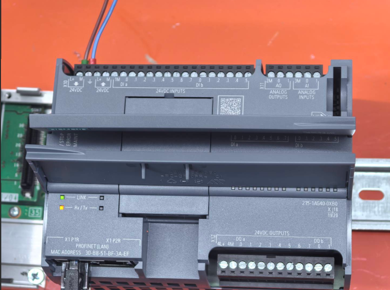

### 1.2 TIA 安装 ISO（`D:\TIA_Portal_STEP7`）

| 顺序 | 文件 |
|------|------|
| 1 | `TIA_Portal_STEP7_Prof_Safety_WinCC_V20.iso` |
| 2 | `TIA_Portal_STEP7_Prof_Safety_WINCC_DVD_2_V20.iso` |

挂载光盘 1 → `Start.exe`（管理员）→ 提示换盘再挂光盘 2。

安装后若弹窗 **「无法找到 MAC 地址 00:00:00:00:00:00，必须重新启动计算机」**：与 PLC 无关，多为网卡/许可探测问题；**重启**、**启用有线/Wi‑Fi 网卡**后再装。

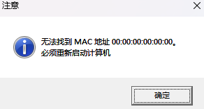

### 1.3 端口说明（易混）

| 端口 | 用途 |
|------|------|
| **102** | 超控 / Snap7 连 **PLC**（设备配置里固定填 **102**） |
| **5112** 等 | TIA **Help Viewer** 安装时本机帮助服务端口，**与 PLC 无关** |

---

## 2. 网络：PC 与 PLC

### 2.1 TIA 项目内 CPU IP（X1）

**设备组态** → 点 CPU → **属性 → 常规 → PROFINET 接口 [X1] → 以太网地址**：

- **在项目中设置 IP 地址**
- IP：`192.168.0.10`，掩码：`255.255.255.0`
- **添加新子网**（不要长期「未连接」）

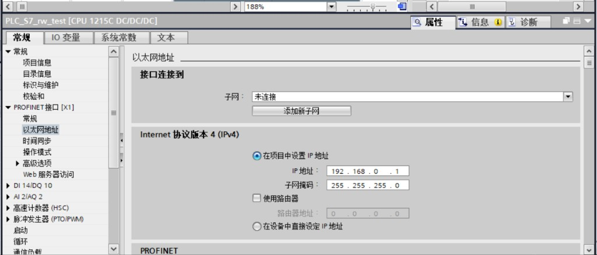

### 2.2 笔记本有线网卡（接 PLC 的以太网）

**设置 → 以太网 → IP 分配 → 手动 → IPv4**（或 `ncpa.cpl`）：

- IP：`192.168.0.20`，掩码：`255.255.255.0`，网关留空  
- **未识别的网络 / 无 Internet** 在直连 PLC 时正常  


### 2.3 自检

```text
ping 192.168.0.10
```

---

## 3. TIA 在线：可访问设备 → 分配 IP → 下载

### 3.1 PG/PC 接口

**在线 → 可访问的设备**：类型 **PN/IE**，接口 **Realtek Gaming GbE**（插 PLC 网线的有线网卡，不是 Wi‑Fi）。


搜索到 **S7-1200**，地址列可能显示 **MAC** 而非 IP → **显示** → 询问是否保存默认 PG/PC 接口 → **是**。

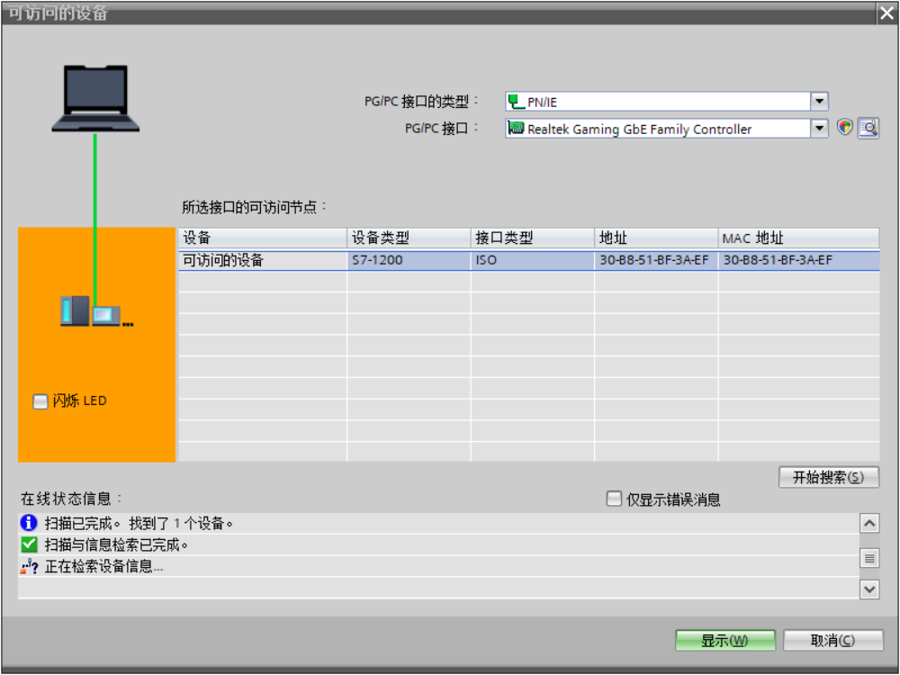

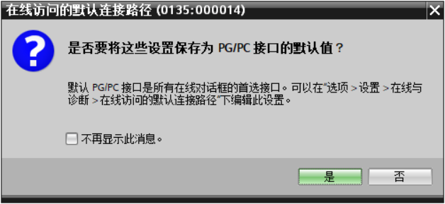

### 3.2 现场 CPU 无 IP（0.0.0.0）导致下载失败

现象：扩展下载里连 **192.168.0.10** 失败，扫描 **0 台** 兼容设备；ping 可能仍通。

原因：项目里写了 IP，**PLC 上尚未写入**（分配 IP 前常为 `0.0.0.0`）。

**在线访问 → Realtek → 可访问的设备 [MAC] → 在线和诊断 → 诊断 → 功能 → 分配 IP 地址**，填 `192.168.0.10` / `255.255.255.0`，点 **分配 IP 地址**。

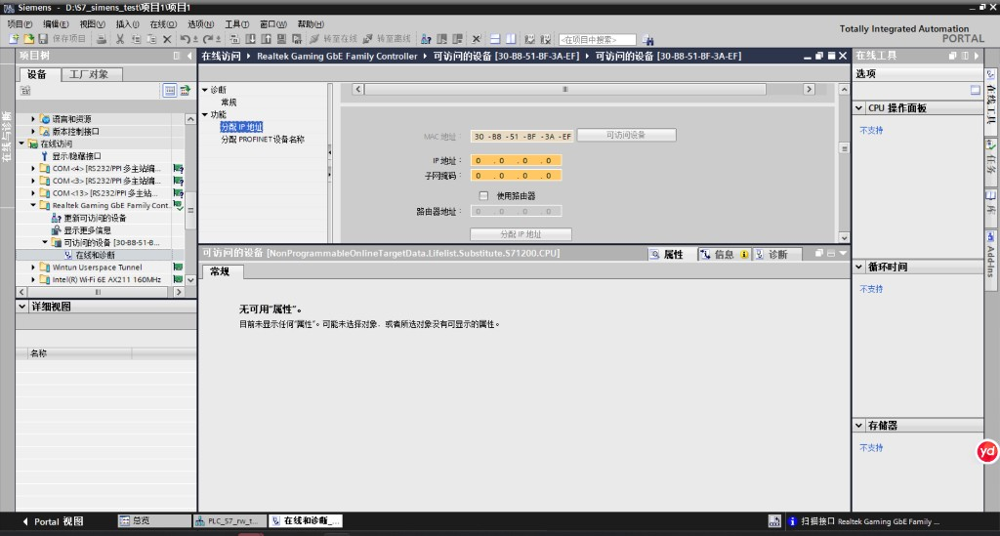

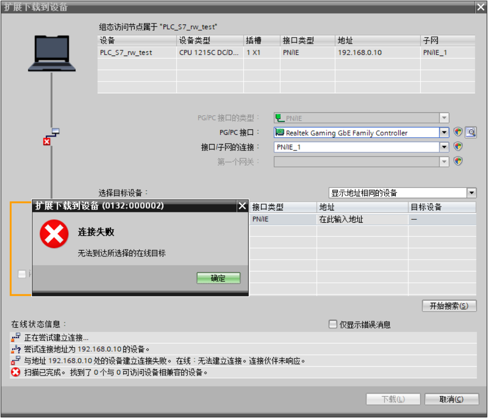

### 3.3 下载到设备

右键 **PLC_S7_rw_test** → **下载到设备**：

- 首次：**硬件和软件（仅更改）** 或 **硬件配置** + **软件**
- 预览点 **装载**；**停止模块** 正常；**DB 在线不存在** 表示新建 DB，勾 **下载到设备** 即可

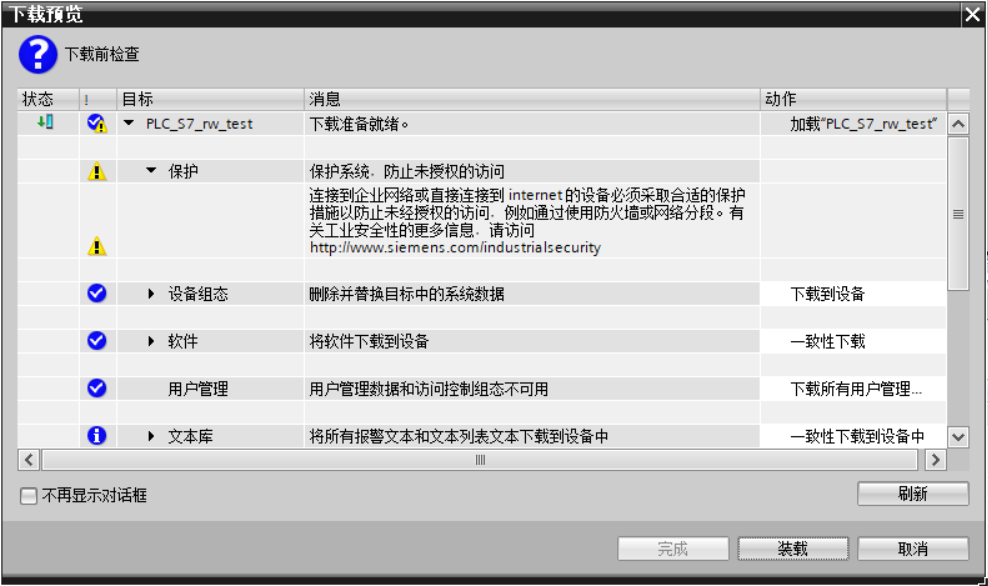

RUN：**下载结果** 中选 **启动模块**；1215C 面板 **RUN 绿灯** 表示在运行。

---

## 4. 访问保护与登录

启用 **PLC 安全设置** 后出现 **经过身份验证** 对话框：

- **用户类型**：多为 **本地用户**（不一定有「项目用户」）
- **用户名**：`admin`（向导里创建）
- **密码错误** 会提示凭证错误或权限不足

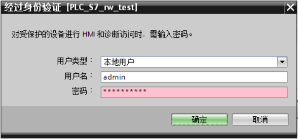

联调可在 **离线** 下：**属性 → 防护与安全 → 保护** → **无保护 / 完全访问无密码** → 下载。

---

## 5. 重点问题：PUT/GET 灰色不可选与「降 CPU 版本」

### 5.1 现象

- **在线**时：**连接机制** 里 **PUT/GET**、**仅安全通信** 等 **全部灰色**。
- **离线** 后仍灰：左侧误点 **子节点「允许 PUT/GET…」**（只读说明页）；应点父级 **「连接机制」**。
- 勾选 **「仅支持 PG/PC 和 HMI 安全通信」** 时，**PUT/GET** 会被禁用。

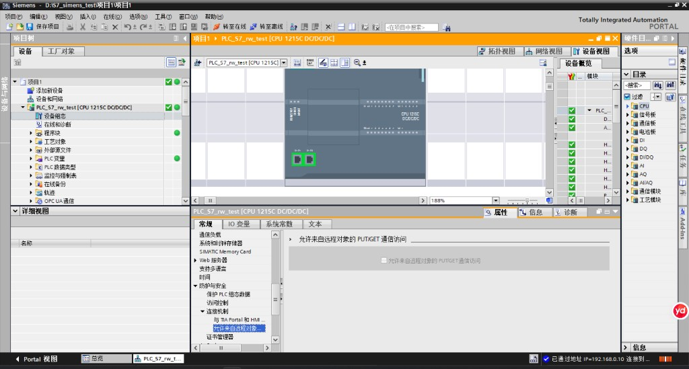

### 5.2 误操作：更改设备 V4.7 → V4.5

网上有「换低版本才能勾 PUT/GET」的说法。**不推荐**。

将项目 CPU 从 **V4.7 改为 V4.5** 时，兼容性警告包括：

- 不再支持统一访问控制与用户管理  
- OPC UA / Web 用户无法迁移  

结果：**登录失败、密码错乱、在线异常**——这是 **版本与安全模型不一致**，不是单纯「西门子 UI BUG」。  
**处理：改回 V4.7（与真机固件一致）** → 本地用户 + admin 登录 → 再配 PUT/GET。

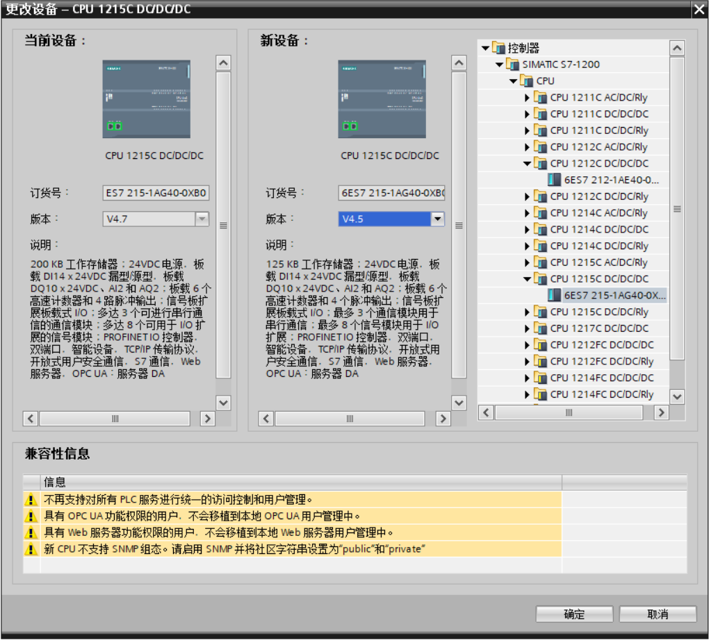

### 5.3 正确做法（实测）

1. **离线** → 点 **连接机制**（父级）  
2. 取消 **仅安全通信**（若能点）  
3. 勾选 **允许来自远程对象的 PUT/GET 通信访问**  
4. 若仍灰：完成 **PLC 安全设置** 向导中 **PG/PC 与 HMI 通信模式**（勿强制仅安全）  
5. **保存 → 硬件和软件下载**（含用户管理）

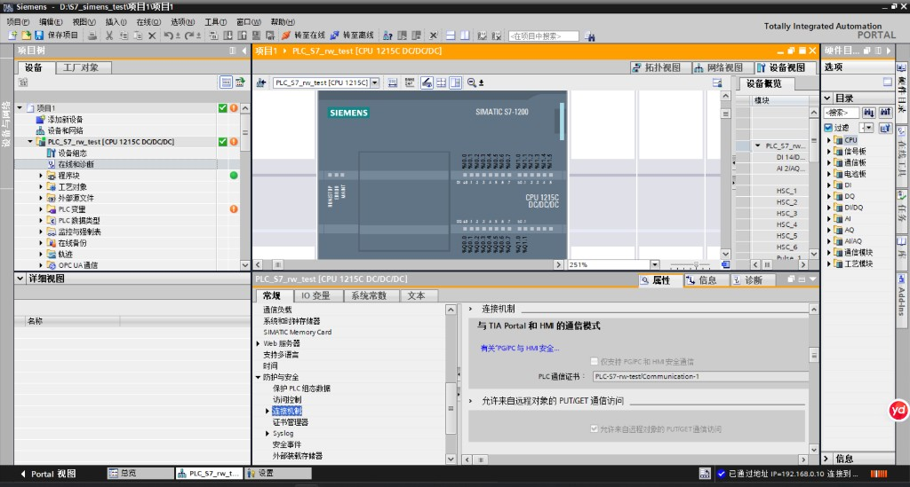

> **说明**：超控 Snap7 走传统 S7/PUT-GET 访问 DB；**PUT/GET** 与证书安全通信冲突时需优先保证 PUT/GET 用于联调。

### 5.4 「项目保护」不是 PLC 安全

**安全设置 → 项目保护 / 保护该项目** 是 **工程文件加密**，与 CPU PUT/GET **无关**。CPU 设置在 **设备组态 → CPU → 属性 → 防护与安全**。

---

## 6. DB1 与非优化访问（Snap7）

### 6.1 创建 DB1

**程序块 → 添加新块 → 数据块**，编号 **1**，名称 **DB1**。

变量示例：`test_byte`，类型 **Byte**，起始值 `16#0`；HMI/OPC 可访问、可写建议勾选。

### 6.2 取消「优化的块访问」

**程序块** 列表中 **右键 DB1 → 属性**（或 DB 表空白处）→ **常规 → 属性** → 取消 **「优化的块访问」** → **确定**。

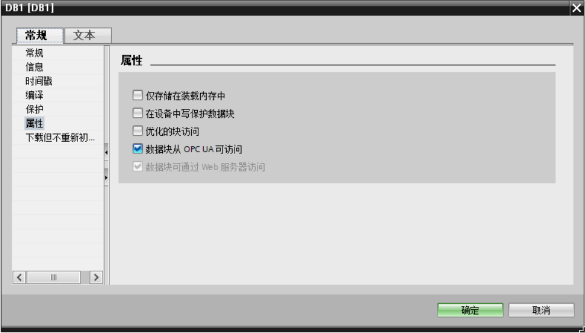

**判断成功**：DB 表出现 **「偏移量」** 列，`test_byte` 为 **0.0**。

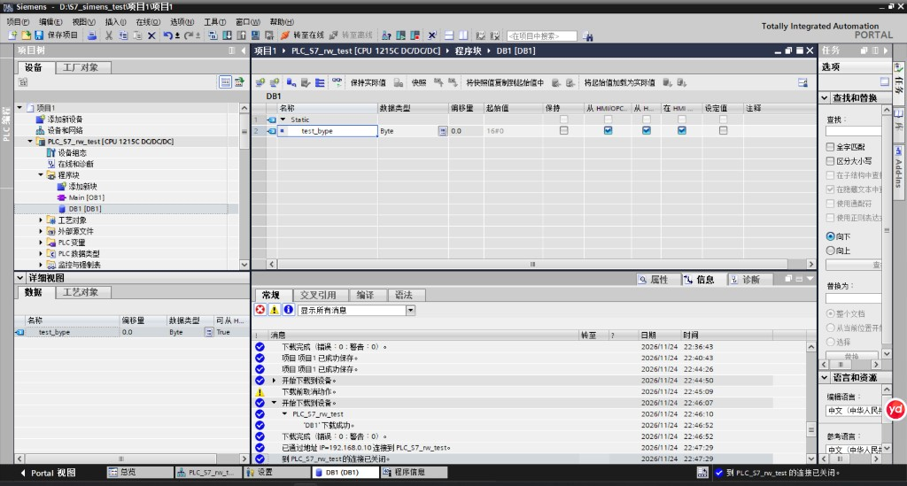

### 6.3 下载

**软件（仅更改）**；预览中 **DB1 对象在线不存在** → 一致性下载 → **装载**。

---

## 7. 超控设备配置与 PLC 测试

### 7.1 设备配置

| 字段 | 值 |
|------|-----|
| 通信协议 | S7 |
| 是否启用 | **开** |
| IP | 192.168.0.10 |
| 端口 | **102** |
| 机架 rack | 0 |
| 槽号 slot | **1**（S7-1200 常用 **1**，勿与 1500 模拟器 slot 0 混用） |

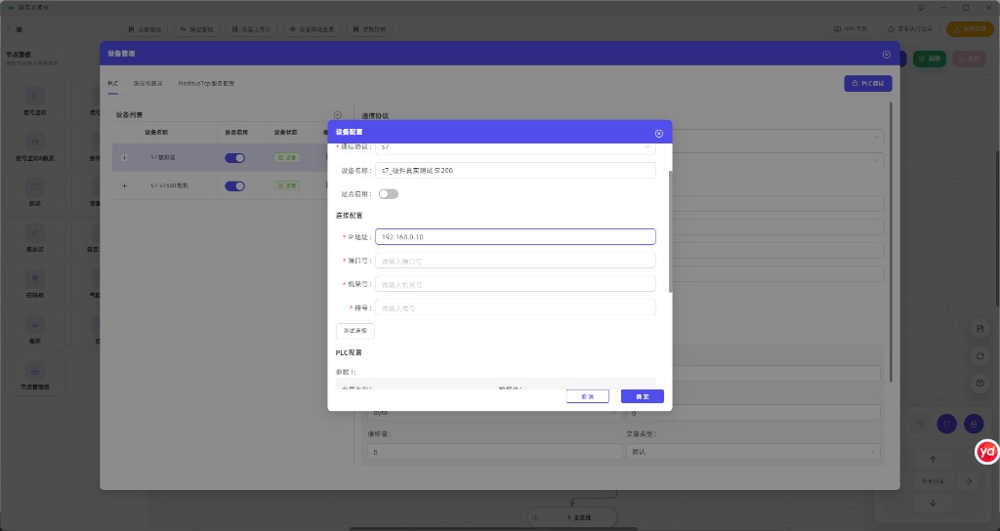

### 7.2 变量参数

| 字段 | 值 |
|------|-----|
| 变量名称 | test_byte |
| 数据块 | 1 |
| 数据类型 | byte |
| 起始位置 | 0 |
| 偏移量 | 0 |
| 变量类型 | 默认 |

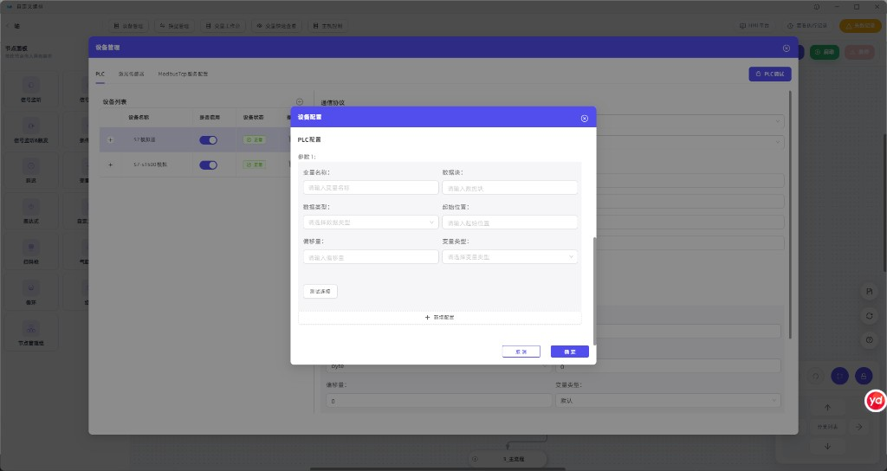

### 7.3 读 / 写测试

- **读取测试**：`code: 200`，`data: 0`（与 DB 初值一致）即成功  

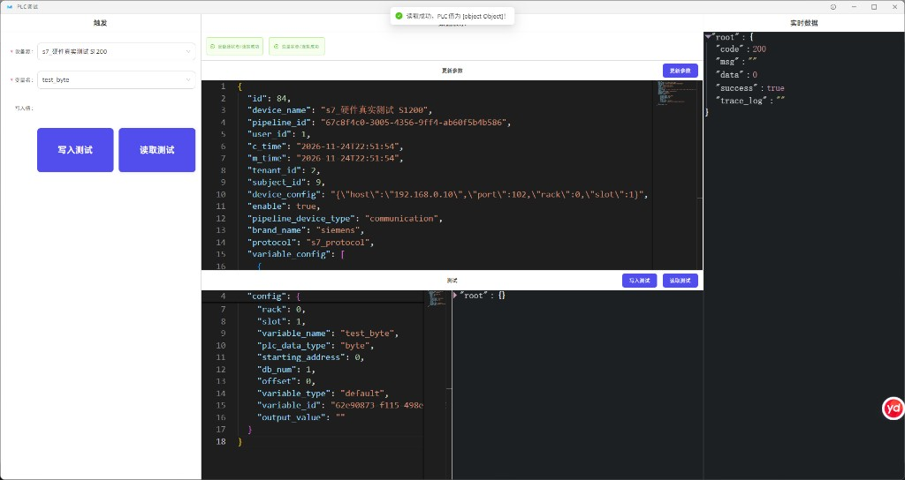

- **写入测试**：左侧 **byte 无写入框** 时，在中间 JSON 将 `"output_value": ""` 改为 **`"output_value": 88`**，再点 **写入测试**  
- **再读取**：`data: 88`

### 7.4 TIA 监视核对

**DB1 → 工具栏「监视全部」（眼镜）**；需 **在线 + RUN**。  
写入 88 后监视值为 **`16#58`**（十六进制 **0x58 = 十进制 88**）。

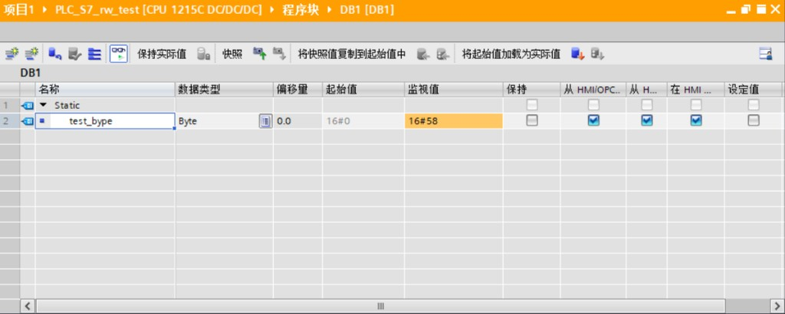

---

## 8. 联调检查清单

| # | 项 |
|---|-----|
| 1 | PC `192.168.0.20`，PLC `192.168.0.10`，`ping` 通 |
| 2 | PLC 已 **分配 IP** 并 **下载组态** |
| 3 | **PUT/GET** 已勾选并 **下载**（勿随意降 CPU 版本） |
| 4 | **DB1** 非优化，**偏移量 0.0**，已 **软件下载** |
| 5 | 超控 **port 102，slot 1**，设备 **已启用** |
| 6 | 读本机 **hw-cc** 含 `byte` 支持（见 [S7_byte_改动说明.md](./S7_byte_改动说明.md)） |
| 7 | 读成功 + 写 `output_value` + TIA 监视 `16#58` |

---

## 9. 常见问题速查

| 问题 | 处理 |
|------|------|
| 可访问设备只有 MAC | **分配 IP** 或下载窗 **搜索选中设备** 再下载 |
| 下载连不上 192.168.0.10 | CPU 上 IP 为 0；先 **分配 IP** |
| PUT/GET 灰 | **离线**、点 **连接机制** 父级、关 **仅安全通信**；勿降 V4.5 |
| 降版本后密码错 | **改回 V4.7**，无保护 + 全量下载，或重新 admin 密码 |
| 登录无「项目用户」 | 用 **本地用户** + admin |
| 监视看不到 | **转至在线**、DB1 **监视全部** |
| 写入失败 | JSON **`output_value`** 不能为空 |

---

## 10. 附录：截图索引

本手册截图位于 `./images/`（`00`～`20`），文件名带序号便于对照上文章节。  
`20-tia-offline-connection-closed.png`：收工 **转至离线** 后拔网线（见 §12.7）。

---

## 11. 验收结论（本次真机）

- **读取**：`test_byte` @ DB1.0 → 成功  
- **写入**：`output_value: 88` → TIA 监视 **16#58** → 与超控读 **88** 一致 → **byte 真机联调通过**

---

## 12. 每次测试前 / 测完后：在线、离线、RUN、STOP

真机联调时 **TIA** 与 **超控** 对 PLC 的占用不同，按场景区分即可。

### 12.1 概念速记

| 状态 | 含义 | 谁需要 |
|------|------|--------|
| **PLC 上电 + 网线** | 硬件通信前提 | TIA、超控都要 |
| **CPU RUN** | 用户程序在执行；**Snap7 读 DB 一般要 RUN** | 超控测 byte 时保持 **RUN** |
| **CPU STOP** | 程序不跑；**下载组态/程序时常会先 STOP** | 主要在 **TIA 下载** 时 |
| **TIA 转至在线** | TIA 与 PLC 建立工程连接（诊断、监视、下载） | 下载、监视 DB、在线诊断 |
| **TIA 转至离线** | TIA 断开工程连接，**可改 CPU 属性**（如 PUT/GET） | 改组态/安全 **前** |
| **超控读/写** | 走 **102 / Snap7**，**不依赖 TIA 是否在线** | 只开 `run_local.py` + 设备启用即可 |

---

### 12.2 每次 **超控 PLC 测试**（读/写 byte）

**测试前**

| 步骤 | 操作 |
|------|------|
| 1 | PLC **上电**，网线接好；PC 有线 IP `192.168.0.20`，**ping 192.168.0.10** 通 |
| 2 | CPU 拨码或 TIA 显示 **RUN**（STOP 灯灭 / RUN 绿灯） |
| 3 | 启动后端：`run_local.py`；HMI 里设备 **已启用**，IP/102/rack0/slot1/DB1 正确 |
| 4 | TIA **可不打开**；若 TIA 已在线也无妨，与超控 **一般可并存**（实验室场景） |

**测试中**

- 在 **PLC 测试** 页：**读取测试** → 改 JSON **`output_value`** → **写入测试** → 再读确认  
- 可选：TIA **转至在线** → DB1 **监视全部**，与超控对照  

**测完后（当天还会测）**

| 建议 | 说明 |
|------|------|
| CPU 保持 **RUN** + 上电 | 下次测超控不用再动 TIA |
| TIA 可 **转至离线** 或关掉 | 省资源；不影响已下载程序 |
| **勿拔线、勿改 PC/PLC IP** | 避免下次 ping/连接失败 |

**测完（今天不再用 PLC）**

| 步骤 | 可选 |
|------|------|
| 停后端 | 结束占用 18920 的 `run_local.py` |
| CPU | **RUN 或 STOP 均可**；长期停用可 **断电** |
| 笔记本网卡 | 若要回公司/家里 Wi‑Fi 上网，以太网可改回 **自动 DHCP** |
| TIA | **转至离线** 后关闭项目 |

---

### 12.3 每次 **TIA 下载 / 改组态**（IP、PUT/GET、DB、安全）

**下载前**

| 步骤 | 操作 |
|------|------|
| 1 | 改 CPU 属性、DB、程序 → **Ctrl+S** |
| 2 | 改 **PUT/GET、保护、连接机制** 等 → 必须先 **转至离线**（在线时多为灰色） |
| 3 | **转至在线**（下载向导里会再选 PG/PC 接口） |
| 4 | 下载预览里 **停止模块 → 全部停止** 属正常（下载瞬间 CPU 会 **STOP**） |

**下载中**

- 点 **装载**；完成后在 **下载结果** 中选 **启动模块**（或手动 **RUN**）

**下载后**

| 步骤 | 操作 |
|------|------|
| 1 | 确认面板 **RUN 绿灯** 或 TIA **在线和诊断** 为 RUN |
| 2 | 若只下了软件/DB → 可直接做 **超控测试**（12.2） |
| 3 | 长期仅监控 → 可 **转至离线**；程序已在 PLC 里，离线不影响超控 |

---

### 12.4 **在线 / 离线 / RUN / STOP** 对照表

| 你要做的事 | 转至在线 | 转至离线 | CPU RUN | CPU STOP |
|------------|----------|----------|---------|----------|
| 改 PUT/GET、保护、设备版本 | ❌ | ✅ 先离线再改 | 无关 | 无关 |
| 下载到设备 | ✅（向导内） | 下完可离线 | 下载后 **RUN** | 下载时会短暂 STOP |
| DB1 监视实际值 | ✅ | ❌ | ✅ 建议 RUN | 监视可能不变/无效 |
| 超控读/写 byte | 不要求 TIA 在线 | — | ✅ **建议 RUN** | ❌ 通常不读写在 STOP |
| 分配 IP（在线和诊断） | 可访问设备 / 在线诊断 | — | 上电即可 | — |
| ping / 测试连接（超控） | 与 TIA 无关 | — | ✅ RUN | 仅 ping 不要求 |

---

### 12.5 推荐日常节奏（byte 联调）

1. **上电 → RUN → ping 通 → 开 run_local.py**  
2. **超控读写**（TIA 开不开都行）  
3. 要改 DB/PUT/GET：**TIA 离线改 → 保存 → 在线下载 → 启动模块 → 再测超控**  
4. **收工**：停后端 → TIA **转至离线** → **可拔网线** →（可选）PLC 断电 → 网卡恢复自动 IP  

---

### 12.6 停后端命令（PowerShell，可选）

```powershell
Get-NetTCPConnection -LocalPort 18920 -ErrorAction SilentlyContinue |
  ForEach-Object { Stop-Process -Id $_.OwningProcess -Force -ErrorAction SilentlyContinue }
```

---

### 12.7 收工拔网线 & 第二天接着测

程序、DB1、IP、PUT/GET 已 **下载进 PLC**，**拔网线不会清掉 PLC 里程序**。第二天 **不必重做整套 TIA**，按表恢复即可。

#### 收工当晚（拔线前）

| 步骤 | 操作 |
|------|------|
| 1 | **停** `run_local.py`（见 12.6） |
| 2 | TIA **转至离线**；信息窗出现 **「到 PLC_xxx 的连接已关闭」** |
| 3 | **直接拔** 笔记本 ↔ PLC 的网线（无须先 STOP CPU） |
| 4 | 可选：PLC **断电**；以太网改回 **自动获取 IP** 以便 Wi‑Fi 上网 |

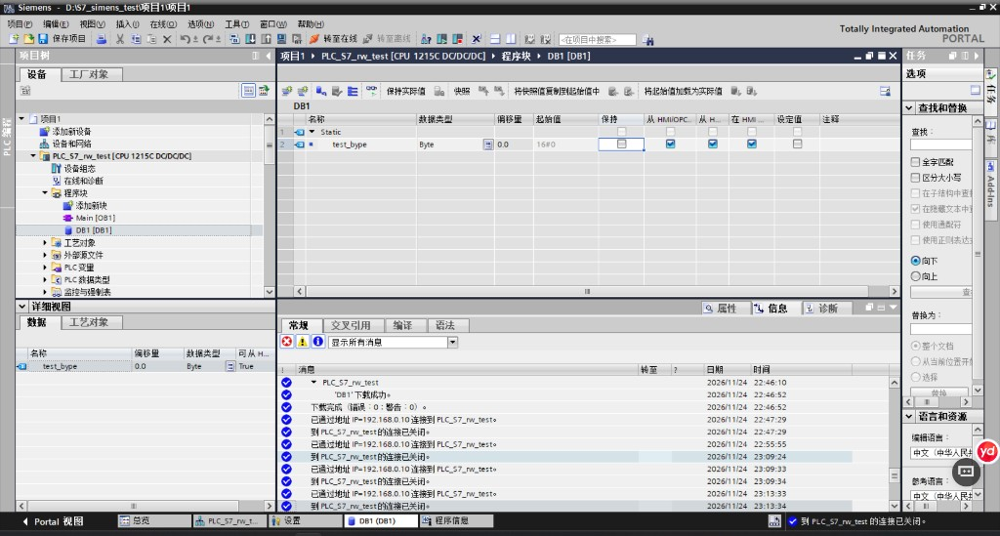

#### 第二天接上再测

| 步骤 | 操作 |
|------|------|
| 1 | PLC **上电**（若昨晚断电） |
| 2 | 插网线（P1 或 P2） |
| 3 | 以太网手动 IP：`192.168.0.20`，掩码 `255.255.255.0`（若曾改回自动，再设一次） |
| 4 | `ping 192.168.0.10` 通 |
| 5 | CPU **RUN**（绿灯；若为 STOP 则拨 RUN 或 TIA 启动） |
| 6 | 启动 `run_local.py`，设备 **已启用** → **PLC 测试** 读/写 byte |

**一般不用重做**：分配 IP、完整下载、建 DB1 —— 除非你在 TIA 里又改了组态且未下载。

#### 仅在这些情况需再开 TIA 下载

- 修改了 **IP / DB / PUT/GET / 保护** → **离线保存 → 下载**  
- **ping 不通** → 查网线、网卡、PC/PLC IP  
- 做过 **存储器复位**（程序清空）→ 重新下载工程  

#### 拔线 / 续测速查

| 动作 | TIA 在线 | 拔网线 | 超控测 byte |
|------|----------|--------|-------------|
| 收工拔线 | 先 **离线** ✅ | ✅ | 先 **停后端** |
| 次日续测 | 可不打开 | 插线 + ping | **RUN** + 启后端即可 |