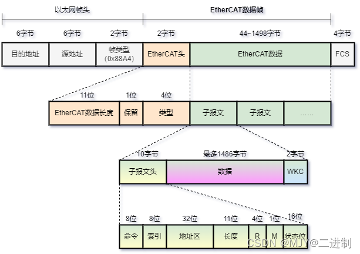
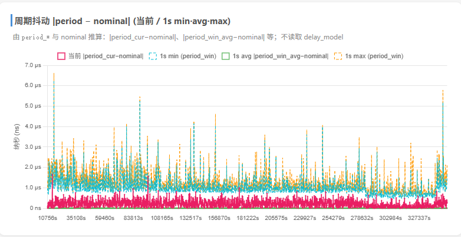
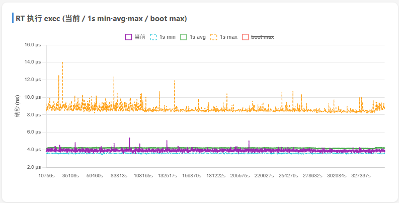

# EtherCAT 扫盲知识库总结

> **面向对象**：第一次接触 EtherCAT 的同事
> **目标**：用 30 分钟建立整体认知，并理解「我们当前项目为什么使用 EtherCAT」
> **用法**：第 0~4 章是全员必读；第 5~7 章是技术细节；第 8 章回答选型问题；第 9~10 章是速查与 FAQ

---

## 0. 三句话总结

1. **EtherCAT 是一条跑在标准网线上的硬实时工业总线**：主站发一帧，所有从站在帧经过的瞬间完成读写，一帧走完整条总线。
2. **它解决的是「确定性」问题**：普通以太网延迟不可预测，EtherCAT 能做到微秒级周期、亚微秒级多轴同步。
3. **我们项目用它，是因为多轴伺服控制必须同时满足 1kHz 周期、多轴同步、可扩展、可诊断、可替换供应商**——EtherCAT 是目前综合成本最低的答案。

---

## 1. 从业务讲起：我们为什么需要一条「工业总线」

### 1.1 我们的场景

我们做的是**多轴机器人 / 伺服运动控制**：控制器每个控制周期（1ms，即 1kHz）要完成一轮闭环：

```
读取所有轴的实际位置/速度/状态
        ↓
计算下一周期的目标位置（插补 / 轨迹规划）
        ↓
把目标位置 + 控制字下发给每一个伺服驱动器
        ↓
驱动器执行 → 反馈新的实际位置
        ↓
进入下一个 1ms 周期
```

轴数不是一两根，而是**多轴同时联动**（当前框架的轴管理上限是 32 轴，实测规模为 9 轴）。对系统来说，最怕的不是「算得慢一点」，而是：

- **某一轴的数据晚到** → 这一轴用旧数据算，轨迹变形；
- **各轴采样时刻不一致** → 插补出来的轨迹本身就是错的；
- **偶发延迟尖峰** → 轻则抖动，重则撞机、损坏设备；
- **故障无法定位** → 不知道是哪个节点、哪根线、哪个参数的问题。

### 1.2 如果不用现场总线，会怎样？

| 方案                     | 典型能力                  | 用在多轴伺服上的问题                                   |
| ---------------------- | --------------------- | -------------------------------------------- |
| **脉冲 / 方向 + 模拟量**      | 点对点，一根轴一组线            | 几十轴 = 线缆爆炸；无参数/诊断通道；无法精确同步；柜内空间和接线成本高        |
| **RS485 / Modbus RTU** | 半双工轮询，ms~几十 ms        | 主站逐个问、从站逐个答，周期长且不确定；没有分布式时钟，多轴同步无从谈起         |
| **CANopen**            | 1Mbps，报文 8 字节         | 轴数多时带宽和周期吃紧；跨厂商配置复杂；不适合 1kHz 多轴大数据量          |
| **普通以太网 TCP/IP**       | 100Mbps~1Gbps，但走完整协议栈 | 协议栈和操作系统调度带来 ms 级不确定抖动；TCP 重传/拥塞控制不可控；不适合硬实时 |
| **EtherCAT**           | 100Mbps，微秒级周期，<1μs 同步 | 需要专用 ESC 从站芯片、实时主站，但综合成本最优                   |

> 一句话：**普通网络是「尽力而为」，运动控制要的是「说到做到」**。晚 10ms 对发邮件无所谓，对 1kHz 的伺服环就是 10 个控制周期。

### 1.3 我们对总线的硬指标

| 需求   | 指标                                 | 为什么            |
| ---- | ---------------------------------- | -------------- |
| 控制周期 | 1ms（1kHz），可到 200Hz~1kHz            | 伺服环、轨迹跟踪的实时性   |
| 多轴同步 | 轴间偏差 < 1μs                         | 多轴插补、机器人末端轨迹精度 |
| 周期抖动 | 越小越好（我们实测 P99 < 1μs）               | 抖动会被位置环放大成机械振动 |
| 可扩展  | 当前框架轴配置上限 32 轴（实测 9 轴），可继续加 IO/传感器 | 产品系列化、产线扩展     |
| 可诊断  | 能定位到节点/线缆/参数                       | 现场维护成本         |
| 开放性  | 不被单一驱动器厂商绑定                        | 供应链与成本         |

**EtherCAT 正好是为这组指标设计的。**

---

## 2. EtherCAT 是什么

### 2.1 定义

> **EtherCAT**（Ethernet for Control Automation Technology）是德国 **Beckhoff（倍福）** 于 2003 年推出的开放式工业以太网现场总线，2007 年成为 IEC 国际标准，2014 年成为中国国家标准。

它**复用标准以太网的物理层**（网线、RJ45、100BASE-TX），但**不使用 TCP/IP 协议栈**，而是定义了一套专用于实时控制的二层协议。因此：

- 物理上：和普通网线一样，CAT5e/CAT6、RJ45、100m 单段；
- 协议上：以太网帧的 `EtherType = 0x88A4` 就是 EtherCAT 的「身份证」；
- 定位上：**它是一条设备总线，不是办公网络**，不跨路由、不上互联网。

生态数据（ETG 官方）：全球累计 **7700 万+** 节点，ETG 会员 **7600+** 家。它已经是多轴伺服/机器人领域的事实标准之一。

### 2.2 主从架构：只有一个「说话的人」

```
        ┌─────────────┐
        │   EtherCAT  │   ← 主站（Master）：唯一可以主动发帧的节点
        │    主站      │      通常是一台带实时系统的工控机/控制器
        └──────┬──────┘
               │ 一帧
     ┌─────────┴─────────┐
     │                   │
┌────┴────┐        ┌────┴────┐        ┌─────────┐
│ 从站 1  │ ─────► │ 从站 2  │ ─────► │ 从站 N  │
│ 伺服/IO │        │ 伺服/IO │        │ 伺服/IO │
└─────────┘        └─────────┘        └────┬────┘
     ▲                                     │
     └────────────── 帧原路返回 ────────────┘
```

- **主站**：唯一主动发送数据帧的节点，负责组帧、发帧、收帧、校验；
- **从站**：不主动发帧，只在帧经过时「顺手」读写自己的那段数据，然后转发；
- **逻辑上是环**：帧从主站出发，依次经过所有从站，到末端后全双工返回主站；
- **物理上可以是线型、树型、星型、环型**（见第 7 章）。

### 2.3 最重要的类比

> **普通以太网像邮政**：每个包裹单独送到每个地址，拆包、处理、再打包。
>
> **EtherCAT 像一列不停站的高铁**：列车从主站出发，每个车站（从站）在列车经过的瞬间，把自己的货扔上车、把给自己的货取下来。列车不停，走完全程后返回。

这个「不停站」的机制，就是 EtherCAT 的核心创新：**On-the-Fly（飞读飞写）**。

---

## 3. 为什么快：On-the-Fly + 硬件处理

### 3.1 On-the-Fly：一帧服务所有从站

传统轮询方式：

```
主站 → 从站1（收完整帧→处理→回复）→ 主站
主站 → 从站2（收完整帧→处理→回复）→ 主站
...
N 个从站 = N 次往返，延迟随节点数线性增长
```

EtherCAT 方式：

```
主站 ──► 从站1 ──► 从站2 ──► 从站3 ──► ... ──► 末端
         飞读/写    飞读/写    飞读/写              │
          ▲                                      │
          └──────────── 全双工返回 ───────────────┘
```

- 一帧遍历所有从站，**不回头、不停站**；
- 每个从站在帧经过的几纳秒内完成读写；
- 帧到末端后利用以太网全双工特性直接返回主站。

**结果**：N 个从站的数据交换只花一帧的时间，而不是 N 次往返。这是 EtherCAT 高带宽利用率的根源。

### 3.2 帧结构：数据怎么装进网线



```
以太网帧：
┌────────┬────────┬──────────────┬─────────────────┬──────┐
│ 目的MAC │ 源MAC  │ EtherType    │ EtherCAT 数据    │ FCS  │
│  6B    │  6B    │ 0x88A4 (2B)  │                 │ 4B   │
└────────┴────────┴──────────────┴─────────────────┴──────┘

EtherCAT 数据：
┌──────────────┬──────────┬──────────┬─────┬──────────┐
│ EtherCAT头(2B)│ Datagram1│ Datagram2│ ... │ DatagramN│
└──────────────┴──────────┴──────────┴─────┴──────────┘

单个 Datagram：
┌─────┬─────┬─────────┬───────┬─────┬──────────┬─────┐
│ Cmd │ Idx │ Address │ Len+M │ IRQ │   Data   │ WKC │
│ 1B  │ 1B  │   4B    │  2B   │ 2B  │ 0~1486B  │ 2B  │
└─────┴─────┴─────────┴───────┴─────┴──────────┴─────┘
```

| 字段          | 作用                              | 通俗理解        |
| ----------- | ------------------------------- | ----------- |
| **Cmd**     | 读 / 写 / 读写命令                    | 告诉从站「要干嘛」   |
| **Idx**     | 帧序号，索引，用于匹配响应                   | 第几号指令       |
| **Address** | 寻址信息，**16 位节点地址 + 16 位从站内存储偏移** | 发给哪个从站/哪段内存 |
| **Len+M**   | 数据长度 + 后续帧标记                    | 这节车厢装了多少货   |
| **IRQ**     | 中断请求                            | 从站有急事报告     |
| **Data**    | 实际数据                            | 货物          |
| **WKC**     | 工作计数器                           | 签收回执（见 6.4） |

> **关键点**：一个 EtherCAT 帧可以塞多个 Datagram，每个 Datagram 可以寻址不同从站或不同内存区域。所以「一帧」不是「一个从站的数据」，而是「整条总线一次交换的数据」。

### 3.3 寻址方式：从站怎么找到自己的数据

| 模式       | 命令前缀                       | 使用阶段          | 原理                                                                              |
| -------- | -------------------------- | ------------- | ------------------------------------------------------------------------------- |
| **自动递增** | APxx                       | 启动扫描/发现从站     | 主站预置目标位置的负偏移（第 1 站 0x0000、第 2 站 0xFFFF…）；帧每经过一个从站，地址字段 **+1**，收到 0x0000 的从站就是目标 |
| **配置地址** | FPxx                       | 配置/诊断         | 主站给每个从站分配固定站号，写进 ESC 寄存器 0x0010                                                 |
| **逻辑地址** | Lxx                        | **实时运行（PDO）** | 主站把各从站的物理内存映射到一整块逻辑地址空间，一帧广播，所有从站同时处理自己那一段                                      |
| **广播**   | Bxx（Broadcast）             | 特殊用途          | 所有从站都执行                                                                         |

> **记忆口诀**：AP 数位置、FP 配地址、B 全发、L 靠映射。
>
> **为什么叫「自动递增」？** ESC 的实际动作是每经过一个从站把地址字段 **+1**；主站预置的是目标位置的**负偏移（16 位补码）**：第 1 站 `0x0000`、第 2 站 `0xFFFF`（−1）、第 3 站 `0xFFFE`（−2）……偏移从负数逐站加到 `0x0000`，收到 0 的从站就是目标。所以「递增」指的是地址字段在总线上逐站递增；主站侧看到的预置值才是依次减 1（0、−1、−2…）。
>
> 运行时最常用的是 **逻辑寻址 + LRW 命令**：一帧同时完成所有从站的读和写。

### 3.4 ESC：从站的「通信大脑」

**ESC = EtherCAT Slave Controller**，是从站里的专用通信芯片。

- 可以是 ASIC（如 ET1100、ET1200、LAN9252、AX58100），成本可以低到几元；
- 也可以是 FPGA IP 核，或集成在 MCU 内部；
- 它**不依赖从站 CPU** 就能完成帧解析、地址匹配、数据搬运、WKC 更新；
- 端口间转发延迟通常只有几十纳秒，远小于 1μs。

> **ESC 负责「通信」，从站 MCU 负责「应用」**：
> ESC 把目标位置交给 MCU，MCU 跑伺服三环；MCU 把实际位置写回 ESC，ESC 再塞回帧里。
> 这就是为什么 EtherCAT 从站可以做到很便宜——通信不需要一颗高性能 CPU。

### 3.5 速度账本

| 指标              | 数值                                       |
| --------------- | ---------------------------------------- |
| 1000 个 I/O 更新时间 | **约 30μs**                               |
| 100 个伺服轴通信      | **约 100μs**（含全部命令值/实际值/状态，取决于每轴 PDO 大小） |
| 分布式时钟同步偏差       | **< 1μs**                                |
| 带宽利用率           | **开销 < 10%**                             |
| 物理层             | 100BASE-TX，100Mbps，全双工                   |
| 单段最大距离          | 100m（CAT5e/CAT6）                         |
| 最大从站数           | 65535=2¹⁶ − 1                            |

> 我们的 1kHz（1ms）控制周期，对 EtherCAT 来说余量非常大：100 轴也只需要 100μs 左右，1ms 周期只占约 1/10。

---

## 4. 为什么稳：分布式时钟 DC

### 4.1 问题：多轴不在「同一时刻」采样

假设两个轴：

```
轴 1 在 T 时刻读到位置 P1
轴 2 在 T + 100μs 时刻读到位置 P2
控制器用 P1、P2 算插补 → 相当于把不同时刻的位置拼在一起 → 轨迹错误
```

轴数越多、速度越快，这个误差被放大得越明显。**所以多轴控制的前提是：所有从站共享同一个时间基准。**

### 4.2 DC 的三步原理

```
第一步：选参考时钟
    第一个支持 DC 的从站 = 参考时钟（Reference Clock）
    其他所有从站 + 主站 = 从时钟

第二步：测量传播延迟
    主站发广播帧 → 各从站记录到达时刻
    主站计算每个从站到参考时钟的延迟差

第三步：周期补偿
    主站周期性发 ARMW/FRMW 帧
    把参考时钟时间写给所有从站
    每个从站按偏移量校准本地时钟
```

> 类比：会议室里有一块**标准钟**，每个人有自己的手表。管理员定期广播「现在标准时间是 XX」，大家按差值校准自己的表。校准是**硬件级**的，不靠软件轮询。

### 4.3 DC 的效果

- 典型同步抖动 **< 1μs**；
- 即使相距 120m 电缆、300 个节点，示波器上看同步误差仍 < 1μs；
- 支持 SYNC0/SYNC1 硬件触发：从站在精确的时刻同时采样输入、更新输出。

### 4.4 三种同步模式

| 模式 | 说明 | 适用场景 |
| --- | --- | --- |
| **Free Run** | 不与 EtherCAT 同步，从站自由运行 | 非实时 IO |
| **SM Sync** | 帧经过时由 SyncManager 事件触发 | 简单从站 |
| **DC Sync（SYNC0/1）** | 由 DC 硬件定时触发 | **伺服驱动（推荐）** |

> **工程提醒**：在我们使用的汇川 IS620N、TC600E 等驱动器上，CSP 模式（周期同步位置）**必须开启 DC**，否则主站和驱动器不在同一节拍上，会出现位置指令错位、运动抖动甚至失控。很多驱动器出厂默认不是 DC Sync0，调试时要特别确认。

---

## 5. 数据怎么交换：PDO / SDO / 状态机 / CiA402

### 5.1 PDO 与 SDO：两条完全不同的通道

|     | **PDO**（Process Data Object） | **SDO**（Service Data Object） |
| --- | ---------------------------- | ---------------------------- |
| 用途  | 周期性实时过程数据                    | 参数配置、诊断                      |
| 触发  | 每个控制周期固定收发                   | 按需、事件触发                      |
| 通道  | SM2/SM3 过程数据通道               | SM0/SM1 邮箱通道                 |
| 实时性 | 高（μs 级）                      | 低（ms 级，不影响 PDO）              |
| 数据量 | 小（每轴几十字节）                    | 大（可达 KB 级，分段传输）              |
| 类比  | **开车时踩油门、打方向**               | **去 4S 店做保养、读故障码**           |

**典型伺服 PDO（CSP 模式）**：

```
主站 → 从站（RxPDO，SM2）：
    控制字 0x6040
    目标位置 0x607A
    目标速度 0x60FF
    运行模式 0x6060

从站 → 主站（TxPDO，SM3）：
    状态字 0x6041
    实际位置 0x6064
    实际速度 0x606C
    故障码 0x603F
```

> 注意方向命名：**RxPDO 是「从站接收」**（主站→从站），**TxPDO 是「从站发送」**（从站→主站）。不要按主站视角理解反了。

### 5.2 从站状态机：四个阶段

每个 EtherCAT 从站上电后必须按顺序走完：

```
Init → Pre-Op → Safe-Op → Op
         ↑          │
         └── 出错回退 ┘

（Bootstrap 为可选，用于固件升级）
```

| 状态 | 邮箱（SDO） | 过程数据（PDO） | 含义 |
| --- | :---: | :---: | --- |
| **Init** | ✗ | ✗ | 上电初始，只能访问 ESC 寄存器 |
| **Pre-Op** | ✓ | ✗ | 可配置参数：PDO 映射、DC 设置等 |
| **Safe-Op** | ✓ | 输入只读 | 输入数据有效，输出保持安全值 |
| **Op** | ✓ | 读写 | 正常工作状态 |

> **现场最常见的故障**：从站卡在 Pre-Op / Safe-Op 进不了 Op。排查顺序：
> 1. ENI 文件与物理总线不匹配（拓扑变了 / PDO 映射不一致）；
> 2. DC 配置错误；
> 3. SDO 参数写入失败（邮箱通信异常）。

### 5.3 协议层——CoE 与 CiA402：伺服驱动的「普通话」

- **CoE（CANopen over EtherCAT）**：在 EtherCAT 上承载 CANopen 的对象字典、PDO/SDO 机制；
- **CiA402**：CANopen 里的**伺服驱动行规**，定义了状态机、控制字/状态字、运行模式、对象字典。

因为大家都说 CiA402，所以不同厂商的 EtherCAT 伺服可以互换——主站只认标准对象，不认品牌。这是 EtherCAT 生态最重要的「软实力」。

**核心对象**：

| 对象 | 名称 | 作用 |
| --- | --- | --- |
| 0x6040 | Controlword | 主站给驱动器的控制字（使能、急停、清故障等） |
| 0x6041 | Statusword | 驱动器状态反馈 |
| 0x607A | Target Position | 目标位置 |
| 0x6064 | Position Actual Value | 实际位置 |
| 0x6060 | Modes of Operation | 运行模式（CSP=8，PP=1 等） |
| 0x6061 | Modes of Operation Display | 当前生效模式 |
| 0x603F | Error Code | 故障码 |

### 5.4 CSP 与 PP：两种位置控制思路

|      | **PP（Profile Position）**    | **CSP（Cyclic Synchronous Position）** |
| ---- | --------------------------- | ------------------------------------ |
| 本质   | 告诉驱动器「走到哪」                  | 告诉驱动器「每个周期走到哪」                       |
| 轨迹计算 | 驱动器内部规划                     | **主站**每周期计算并下发                       |
| 优点   | 上位机负担小，轨迹平滑由驱动器保证           | 轨迹完全可控，支持多轴插补/机器人运动                  |
| 缺点   | 灵活性低，轴间协同弱                  | 对主站实时性、DC 同步要求高                      |
| 适用   | 简单点位、单轴                     | **多轴插补、CNC、机器人**                     |
| 主站发的 | 目标位置 **+ 速度/加速度/减速度参数**（一次） | 目标位置**点**（每个周期一个）                    |

> 我们的项目采用 **CSP + DC**：主站每 1ms 计算所有关节的目标位置，通过 PDO 下发，驱动器按 DC 节拍跟随。这样才能保证多轴轨迹的同步与精度。

### 5.5 一个 1ms 周期里发生了什么

```
主站（RT 线程）
  │
  ├─ ① 收上一周期帧，取出所有轴的 TxPDO（实际位置/状态/故障）
  ├─ ② 运行控制算法：根据轨迹点算出本周期的目标位置
  ├─ ③ 把 RxPDO（控制字 + 目标位置）写进发送缓冲
  ├─ ④ DC 同步：校准主站/从站时钟
  ├─ ⑤ 发帧（一帧包含所有轴的数据）
  │
  ▼
EtherCAT 总线（帧依次经过每个从站）
  │
  ├─ 每个从站 ESC：FMMU 命中 → 取走自己的目标位置 → 放回实际位置
  │
  ▼
主站收到返回帧 → 检查 WKC → 进入下一个 1ms 周期
```

---

## 6. 从站内部：ESC / FMMU / SM / EEPROM

> **一句话记忆**：**EEPROM 存身份 → SII 读身份 → FMMU 找数据 → SM 递数据 → MCU 用数据**。

### 6.1 五大模块

| 模块 | 全称 | 是什么 | 作用 |
| --- | --- | --- | --- |
| **ESC** | EtherCAT Slave Controller | 通信专用芯片（ASIC/FPGA/IP） | 帧解析、地址匹配、数据搬运、DC |
| **FMMU** | Fieldbus Memory Management Unit | ESC 内部地址映射单元 | 把主站逻辑地址映射到从站本地物理地址 |
| **SM** | SyncManager | ESC 内部数据通道（标准 4 个） | 主站与 MCU 共享内存的访问同步 |
| **EEPROM** | Electrically Erasable PROM | 从站板上的存储芯片 | 持久化保存从站身份/配置 |
| **SII** | Slave Information Interface | ESC 内部读取控制器 | 上电自动读 EEPROM，供主站查询 |

### 6.2 FMMU：门牌号映射表

EtherCAT 运行时用**逻辑寻址**：主站眼里是一整块连续的地址空间，每个从站占其中一段。

```
主站逻辑地址空间：
┌──────────┬──────────┬──────────┬──────────┐
│ 从站1数据 │ 从站2数据 │ 从站3数据 │ 从站4数据 │
│ 0x0000   │ 0x0040   │ 0x0080   │ 0x00C0   │
└────┬─────┴────┬─────┴────┬─────┴────┬─────┘
     ▼          ▼          ▼          ▼
  从站1 FMMU  从站2 FMMU  从站3 FMMU  从站4 FMMU
     │          │          │          │
     ▼          ▼          ▼          ▼
  本地 RAM    本地 RAM    本地 RAM    本地 RAM
```

- 帧经过从站时，FMMU 检查「这段逻辑地址是否命中我」；
- 命中 → 从帧里取数据（输出）或把数据插入帧（输入）；
- 不命中 → 直接转发，不做任何事。

> 类比：主站不喊「从站 2 你出来」，而是喊「谁在 0x0040-0x007F 这段？」——FMMU 负责应答。

### 6.3 SM：带锁的传递窗

SM 管理 ESC 与从站 MCU 之间的共享内存，标准分配：

| 通道 | 方向 | 用途 |
| --- | --- | --- |
| **SM0** | 主站 → 从站 | 邮箱输出（SDO 请求） |
| **SM1** | 从站 → 主站 | 邮箱输入（SDO 应答） |
| **SM2** | 主站 → 从站 | 过程数据输出（RxPDO） |
| **SM3** | 从站 → 主站 | 过程数据输入（TxPDO） |

SM 的三个机制：**握手**（写完通知对方）、**一致性保护**（读的时候不许写）、**中断通知**（门铃）。

### 6.4 WKC：通信成功的「签收单」

**WKC = Working Counter（工作计数器）**：

| 操作 | WKC 增量 |
| --- | :---: |
| 读 | +1 |
| 写 | +2 |
| 读写 | +3 |

主站发帧时预设**期望 WKC**；每个从站处理完自己的 Datagram 后递增 WKC；帧返回后主站对比：

- 实际 WKC == 期望 WKC → 所有从站都响应了；
- 实际 WKC < 期望 WKC → 有从站没响应/掉线/配置不对 → 报警。

> 类比：寄出 5 个包裹，每签收一个盖一个章；回来只有 4 个章，就知道有一个没送到。

### 6.5 ESI / ENI / EEPROM / SII 的关系

```
ESI 文件（XML，厂商提供的「设备说明书」）
        │ 内容一致（二进制/XML 两种形态）
        ▼
EEPROM（从站板上的「身份证芯片」）
        │ 上电自动读取
        ▼
SII（ESC 内部的「读卡器」）
        │ 主站查询
        ▼
主站获得从站能力 → 结合拓扑生成 ENI（整条总线的「施工图」）
        │ 主站加载
        ▼
配置 FMMU / SM / PDO / DC → 从站进入 Op
```

- **ESI**：单个从站的能力描述（厂商提供）；
- **ENI**：整个网络的拓扑 + 配置（TwinCAT/CODESYS 等配置工具生成，主站加载；IgH 也支持用命令/代码完成等价配置）；
- 换从站型号 → 更新 ESI → 重新生成 ENI（或重新配置）；
- 从站进不了 Op，首先怀疑网络配置与物理总线不一致（拓扑变化或 PDO 映射不匹配）。

### 6.6 常用调试命令（IgH 主站）

```bash
ethercat slaves          # 查看从站列表和状态
ethercat master          # 查看主站状态
ethercat pdos            # 查看 PDO 映射
ethercat slave -v -p 1   # 查看指定从站详情
ethercat upload -p 1 0x1008 0          # 读 SDO
ethercat download -p 1 0x60FF 0 1000   # 写 SDO
ethercat fmmu -p 1       # 查看 FMMU 配置
ethercat sm -p 1         # 查看 SM 配置
ethercat sii_read -p 1   # 读 EEPROM/SII
```

---

## 7. 拓扑与接线

### 7.1 支持的拓扑

```
线型（最常用）：主站 ── A ── B ── C ── D
树型：          主站 ── A ── B
                        └── C ── D
星型：          主站 ── Junction ── A
                          ├── B
                          └── C
环型（冗余）：  主站 ── A ── B ── C ── 主站
```

- **线型/菊花链**：接线最简单，产线和机器人最常用；
- **树型/星型**：需要支持分支的从站或 Junction；
- **环型**：配合线缆冗余，断一根线仍可通信，适合高可用场景。

### 7.2 接线要点

| 项目   | 要求                  |
| ---- | ------------------- |
| 线缆   | CAT5e/CAT6 屏蔽双绞线    |
| 物理层  | 100BASE-TX，全双工      |
| 单段长度 | ≤ 100m              |
| 接头   | RJ45（工业可用 M12）      |
| 屏蔽层  | 两端可靠接地，接地电阻 < 1Ω    |
| 布线   | 不与动力线同槽，远离变频器/伺服动力线 |
| 终端   | 最后一个从站建议启用终端电阻      |

> **注意**：EtherCAT 的「网线」虽然和普通网线一样，但**不能随便接普通交换机/路由器**。它走的是 EtherType 0x88A4 的二层协议，需要主站专用网口和 EtherCAT 从站/Junction。主站网口也不要和办公网络混用。

---

## 8. 重点：我们项目为什么使用 EtherCAT

### 8.1 需求 → 能力对照

| 我们的需求                  | EtherCAT 的能力                     | 结论  |
| ---------------------- | -------------------------------- | --- |
| 1kHz 控制周期              | 100 轴约 100μs，1kHz 余量 10 倍        | ✅   |
| 多轴同步 < 1μs             | DC 分布式时钟，硬件同步                    | ✅   |
| 轴配置上限 32 轴（实测 9 轴），可扩展 | 单网段 65535 节点，线型扩展方便              | ✅   |
| 低抖动、零丢帧                | 硬件转发 + 实时主站，实测 0 丢帧              | ✅   |
| 驱动器可替换                 | CiA402 标准行规，多家伺服支持               | ✅   |
| 成本可控                   | 开源 IgH 主站 + 标准 x86 + 普通 Intel 网卡 | ✅   |
| 可诊断                    | WKC、状态机、SDO 故障码、DC 状态            | ✅   |
| 布线简洁                   | 一根网线菊花链，替代几十根脉冲/编码器线             | ✅   |

> 说明：上表中的「32 轴」是**当前软件框架的配置上限**（`AxisManager` 最多 32 个 `AxisSlot`，YAML 可配），不是 EtherCAT 协议上限（协议可寻址 65535 个节点），也不代表已经实测跑满 32 轴。当前长稳测试规模是 9 轴。

### 8.2 与其它方案对比

| 维度 | 脉冲/模拟量 | RS485/Modbus | CANopen | 普通以太网 TCP/IP | **EtherCAT** |
| --- | --- | --- | --- | --- | --- |
| 典型周期 | 受限于脉冲频率 | ms~几十 ms | ms 级 | ms~百 ms，不确定 | **100μs~1ms** |
| 多轴同步 | 无 | 无 | 较弱 | 无 | **<1μs（DC）** |
| 布线 | 每轴一组线 | 两线总线 | 两线总线 | 交换机星型 | **一根网线菊花链** |
| 诊断能力 | 弱 | 一般 | 一般 | 强（但非实时） | **强（WKC/状态机/SDO）** |
| 驱动器生态 | 通用但老旧 | 少 | 有 | 不适用 | **伺服主流** |
| 成本 | 低（单轴） | 低 | 中 | 低 | 中（ESC 芯片 + 实时主站） |
| 适用 | 简单单轴 | 慢速设备/仪表 | 中等实时 | IT/监控 | **硬实时多轴运动控制** |

> EtherCAT 不是唯一能做到的：Profinet IRT、Powerlink、Sercos III 也能做硬实时。但在**伺服驱动生态、成本、开放性**的综合平衡上，EtherCAT 是目前最适合我们的。

### 8.3 生态与成本：为什么不用专用运动控制卡？

传统方案常用「工控机 + 专用运动控制卡」，问题是：

- 卡和软件绑定厂商，扩展/替换成本高；
- 轴数受卡槽/通道限制；
- 底层是黑盒，出问题难定位；
- 上位机与卡之间还要再走一层总线/驱动。

我们的方案：

```
标准 x86 工控机
  + Intel I226-V 网卡（igc 原生驱动）
  + Ubuntu + PREEMPT-RT 实时内核（6.1.59-rt16）
  + 开源 IgH EtherCAT 主站（1.6.9）
  + 我们自己实现的 RT 控制框架
        ↓
EtherCAT 总线
        ↓
TC600E 等 CiA402 伺服驱动器 × N
```

好处：

- **硬件通用**：普通工控机 + 普通 Intel 网卡，不依赖专用卡；
- **软件可控**：主站源码可见，PDO 映射、DC 参数、调度策略都能按项目优化；
- **驱动器可选**：只要支持 CiA402/CoE，就能接入，避免被单一厂商锁定；
- **成本可控**：从站 ESC 芯片已高度集成，量产成本低；省下的线缆/柜内空间也是成本。

### 8.4 我们的实际架构

```
┌─────────────────────────────────────────────────────────────┐
│  Non-RT 进程（非实时）                                        │
│  Ruckig 轨迹规划 / ROS2 / Python 脚本 / 遥操作输入             │
│  职责：轨迹规划、IK、人机交互（~10Hz 级）                       │
└──────────────────────────┬──────────────────────────────────┘
                           │ 共享内存 SHM
                           │ （轨迹点队列 / 状态快照 / 事件 / 命令）
┌──────────────────────────▼──────────────────────────────────┐
│  RT 进程 robot_ctl_rt（硬实时，1kHz）                         │
│  ┌────────────┐ ┌──────────────┐ ┌──────────────────────┐  │
│  │ AxisManager│ │ EtherCAT     │ │ CiA402 状态机 / CSP   │  │
│  │ 轴管理      │ │ Master (IgH) │ │ DC 同步 / 周期监控     │  │
│  └────────────┘ └──────┬───────┘ └──────────────────────┘  │
│  运行在隔离核（isolcpus），SCHED_FIFO，内存锁定（mlockall）    │
└──────────────────────────┬──────────────────────────────────┘
                           │ EtherCAT（100Mbps，全双工）
┌──────────────────────────▼──────────────────────────────────┐
│  伺服驱动器 × N（TC600E，CoE/CSP 模式，CiA402 状态机）          │
│  → 电机 / 编码器 / 抱闸 / 限位 / 安全信号                      │
└─────────────────────────────────────────────────────────────┘
```

**为什么 RT / Non-RT 要分离？**

- 轨迹规划（Ruckig、IK、ROS2 通信）计算量大、耗时不确定，不能放进 1ms 硬实时循环；
- RT 进程只做「收帧 → 读反馈 → 写目标 → 发帧」的确定性工作；
- 两者通过共享内存交换数据，互不阻塞。这样既保证实时性，又保留规划灵活性。

**为什么主站还需要 PREEMPT-RT + 核隔离？**

EtherCAT 只保证「帧在总线上的确定性」，但帧什么时候被主站发出去，取决于操作系统调度：

- 普通 Linux 内核：进程可能被抢占、中断可能延迟 → 发帧晚几百 μs；
- PREEMPT-RT 内核 + 隔离核 + `SCHED_FIFO` + `mlockall`：把 RT 线程的调度抖动压到 μs 级；
- 我们的配置：`isolcpus=4-9 nohz_full=4-9 rcu_nocbs=4-9 irqaffinity=0-3 sched_rt_runtime_us=-1`，RT 线程绑定隔离核，日志/监控移到非隔离核。

> 一句话：**EtherCAT 保证总线，实时内核保证主站**。两者缺一不可。

### 8.5 我们的实测性能

测试条件：9 轴，1kHz 周期，Linux 6.1.59-rt16 + IgH 1.6.9，RT 线程隔离核，连续运行 **99.6 小时**。

| 指标 | 实测结果 | 说明 |
| --- | --- | --- |
| 连续运行 | **99.6 h** | 长时稳定性测试 |
| deadline miss | **0** | 没有错过任何控制周期 |
| cons_miss | **0** | 消费侧无漏周期 |
| 周期抖动均值 | **0.23μs** | 相对 1ms 周期的偏差 |
| 周期抖动 P99 | **0.74μs** | 99% 的周期抖动在此以内 |
| 周期抖动最大值 | **10.82μs** | 长时测试中的最坏毛刺 |
| RT 执行耗时均值 | **3.91μs** | 一圈 `runOneCycle()` 的平均耗时 |
| RT 执行耗时 P99 | **4.28μs** | |
| CPU 利用率 | **约 0.7%**（0~4%） | 隔离核上的 RT 负载 |
| 累计丢帧 | **0** | 整个测试期间 |





> 结论：1kHz、9 轴、长时运行下，系统仍有非常大的性能余量。即使扩展到框架上限 32 轴，EtherCAT 和主站的算力也远未到瓶颈。

### 8.6 选型结论

- **EtherCAT 用在「硬实时运动控制层」**：多轴伺服、机器人关节、需要 1kHz/μs 级同步的场合；
- **Modbus/串口/普通 TCP 用在「慢速设备/监控层」**：温湿度、仪表、扫码器、产线辅助设备；不需要硬实时，成本和接线更简单；
- **不要神话 EtherCAT**：它不负责「设备语义」和「产线编排」，那是上层平台（如 SuperCTL）的事；它只负责把「控制字/目标位置」确定性地送到每个从站，再把「状态字/实际位置」带回来。
- **什么时候不必用 EtherCAT**：单轴简单定位、成本极度敏感、没有实时要求、从站不支持 EtherCAT——这些场景用脉冲/Modbus 更划算。

---

## 9. 常见问题 FAQ

**Q1：EtherCAT 和普通以太网有什么区别？能接交换机吗？**

物理层一样（网线、RJ45、100Mbps），但 EtherCAT 不走 TCP/IP，而是用 `EtherType 0x88A4` 的二层协议。主站需要专用网口；过程数据段不应接普通交换机/路由器（除非是 EtherCAT 专用 Junction）。它不能跨路由上网。

**Q2：为什么不能用 TCP/IP 做 1ms 控制？**

TCP/IP 协议栈本身有排队、重传、拥塞控制；操作系统调度也有不确定性。即使物理链路是 100Mbps，端到端延迟也可能在 ms 级抖动。运动控制要的是「每个周期准时到」，不是「平均很快」。

**Q3：PDO 和 SDO 到底怎么选？**

周期性、实时控制数据（控制字、目标位置、实际位置）→ **PDO**；参数配置、故障诊断、固件升级 → **SDO**。PDO 在初始化时映射好，运行时不再变；SDO 按需走邮箱，不占实时通道。

**Q4：为什么 CSP 必须开 DC？**

CSP 是「主站每周期下发目标位置，驱动器按周期跟随」。如果主站和驱动器不在同一时间基准上，目标位置和驱动器执行时刻错位，就会抖动/失控。DC 让所有从站在同一节拍上采样和更新。PP 模式由驱动器自己规划轨迹，对 DC 的依赖相对低，但建议也开。

**Q5：从站卡在 Pre-Op / Safe-Op 怎么办？**

按顺序查：① ENI 与物理拓扑/PDO 映射是否一致；② DC 配置（SYNC0/1、周期、shift）是否正确；③ SDO 参数是否写入成功（邮箱是否正常）；④ 用 `ethercat slave -v`、`ethercat pdos`、`ethercat sm`、`ethercat fmmu` 逐项核对。

**Q6：线型拓扑断一根线会怎样？**

断点之后的从站全部失联（WKC 不匹配）。如果业务要求高可用，用环型拓扑 + 线缆冗余，断一根线仍可从另一方向通信。

**Q7：EtherCAT 主站为什么还要实时内核？**

EtherCAT 只保证总线协议；主站发帧的时刻由操作系统调度决定。普通 Linux 的调度/中断抖动可能达到几百 μs，会直接吃掉 1ms 周期的余量。PREEMPT-RT + 核隔离 + RT 优先级把这段抖动压到 μs 级。

**Q8：框架上限 32 轴、1kHz 会不会不够？**

不会。ETG 给出的参考是 100 轴约 100μs 通信时间；我们 9 轴 1kHz 实测 RT 执行均值约 3.9μs、CPU 约 0.7%。从总线容量看，32 轴余量很大；但这是软件框架的配置上限，当前只实测到 9 轴，实际能否稳定跑到 32 轴，还要看主站控制算法、轨迹规划耗时和机械负载，而不只是 EtherCAT 带宽。

**Q9：EtherCAT 和 Modbus 是什么关系？**

两者不是替代关系，而是分层使用：EtherCAT 用于硬实时运动控制；Modbus/串口用于慢速设备、仪表、辅助 IO。一个系统里完全可以同时存在。

**Q10：EtherCAT 是开放标准吗？会不会被某一家绑定？**

EtherCAT 是开放的 **IEC 61158 / IEC 61784** 系列标准，由 ETG 维护；主站有开源实现（IgH、SOEM），从站芯片有多家供应商（ET1100、LAN9252、AX58100 等），伺服只要遵循 CiA402 就可互换。开放性是我们选型的重要理由之一。

---

## 10. 术语速查表

| 术语 | 英文/全称 | 一句话解释 |
| --- | --- | --- |
| EtherCAT | Ethernet for Control Automation Technology | 硬实时工业以太网总线 |
| 主站 | Master | 唯一主动发帧的节点，通常是一台实时控制器 |
| 从站 | Slave | 伺服/IO/传感器等设备，被动读写并转发帧 |
| ESC | EtherCAT Slave Controller | 从站通信芯片，负责帧处理 |
| PDO | Process Data Object | 周期性实时数据通道 |
| SDO | Service Data Object | 参数配置/诊断通道（邮箱） |
| RxPDO | Receive PDO | 主站→从站的过程数据 |
| TxPDO | Transmit PDO | 从站→主站的过程数据 |
| FMMU | Fieldbus Memory Management Unit | 逻辑地址→物理地址映射 |
| SM | SyncManager | ESC 与 MCU 之间的数据缓冲区/同步通道 |
| DC | Distributed Clock | 分布式时钟，多轴同步的核心 |
| WKC | Working Counter | 工作计数器，判断从站是否响应 |
| ESI | EtherCAT Slave Information | 单个从站的 XML 描述文件 |
| ENI | EtherCAT Network Information | 整条总线的配置文件 |
| SII | Slave Information Interface | ESC 内部读取 EEPROM 的接口 |
| CoE | CANopen over EtherCAT | 在 EtherCAT 上跑 CANopen 对象字典 |
| CiA402 | CANopen drive profile | 伺服驱动标准行规（状态机/对象） |
| CSP | Cyclic Synchronous Position | 周期同步位置模式（主站每周期下发位置） |
| PP | Profile Position | 轮廓位置模式（驱动器自己规划轨迹） |
| On-the-Fly | — | 帧经过从站时即时读写，不停站 |
| LRW | Logical Read Write | 逻辑寻址读写的 Datagram 命令 |
| SYNC0/1 | — | DC 硬件同步触发信号 |

---

## 11. 延伸阅读（知识库内）

### 原理与概念
- [[EtherCat/EtherCAT底层原理精讲（培训用）.md]] —— 最推荐的入门材料，含 On-the-Fly、帧结构、ESC、DC、PDO/SDO 全流程
- [[EtherCat/EtherCAT总线通信技术全解析（完整版）.md]] —— 体系化全解析，含与以太网/其它总线的对比、拓扑、冗余、设备行规
- [[EtherCat/架构概念/核心概念.md]] —— PDO/SDO、ESI/ENI、ESC 内部模块（FMMU/SM/EEPROM/SII）详解
- [[EtherCat/架构概念/EtherCAT的拓扑结构.md]] —— 拓扑与接线细节
- [[EtherCat/DC同步/(笔记)深入解读EtherCAT时钟DC同步的三种模式.md]] —— DC 三种同步模式与丢帧问题

### 工程实践
- [[EtherCat_feishu/EtherCat_知识库.md]] —— Ubuntu + RT 内核 + IgH 主站安装配置全流程
- [[EtherCat_feishu/控制代码注意事项知识库.md]] —— CSP/PP 区别与 CSP 必须开 DC 的工程提醒
- [[EtherCat_feishu/Ubuntu 环境准备（核隔离方式）.md]] —— 核隔离环境准备
- [[EtherCat/核隔离/机器人控制_EtherCAT核隔离配置手册.md]] —— x86/ARM 核隔离配置手册
- [[EtherCat/性能分析/Linux实时调度与PREEMPT-RT详解 RT调度器机理与硬实时工程实践.md]] —— RT 调度与 PREEMPT-RT 原理
- [[EtherCat/motor_servo/代码框架.md]] —— 我们项目的多轴伺服控制架构与主循环
- [[EtherCat/motor_servo/demo_vs_project_comparison.md]] —— Demo 与项目在 PDO/DC/CiA402 上的差异
- [[EtherCat/0_测试工程 内核态&&稳定性/内核态测试.md]] —— 9 轴稳定性实测数据
- [[EtherCat/0_优化工程/日志系统/日志系统分离前后性能对比测试报告.md]] —— 99.6h 长时测试与抖动/执行耗时对比
- [[EtherCat/1_Ethercat主站CMD命令/【原创】IgH EtherCAT主站详解(十七)--命令行管理工具解析及使用说明.md]] —— IgH 命令行工具详解

---

## 附：给同事讲解的 10 分钟路线

如果只讲 10 分钟，按这个顺序：

1. **业务痛点（2min）**：多轴 1kHz，普通网络/串口做不到确定性；
2. **EtherCAT 是什么（2min）**：一列不停站的高铁，一帧服务所有从站；
3. **为什么快（2min）**：On-the-Fly + ESC 硬件处理 + 逻辑寻址；
4. **为什么稳（2min）**：DC 分布式时钟，多轴 <1μs 同步；
5. **我们怎么用（2min）**：IgH 主站 + CSP + DC，实测 9 轴 99.6h 零 deadline miss。

> 记住三个词就够了：**On-the-Fly（快）、DC（准）、CiA402（通）**。
