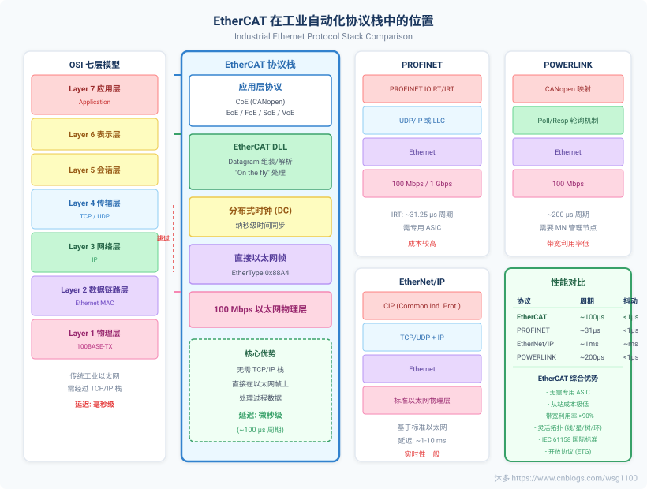
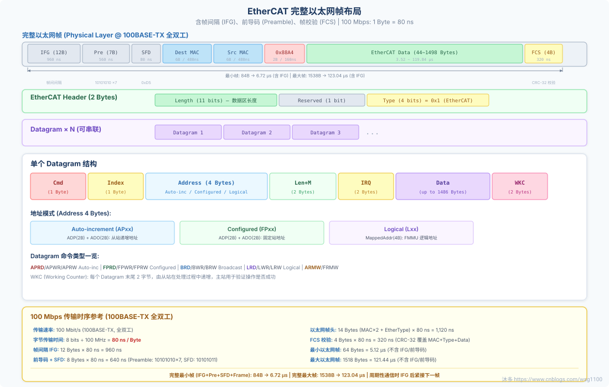
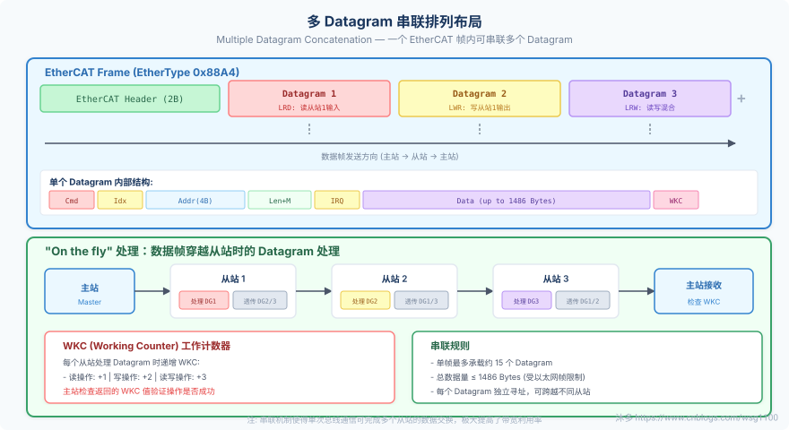
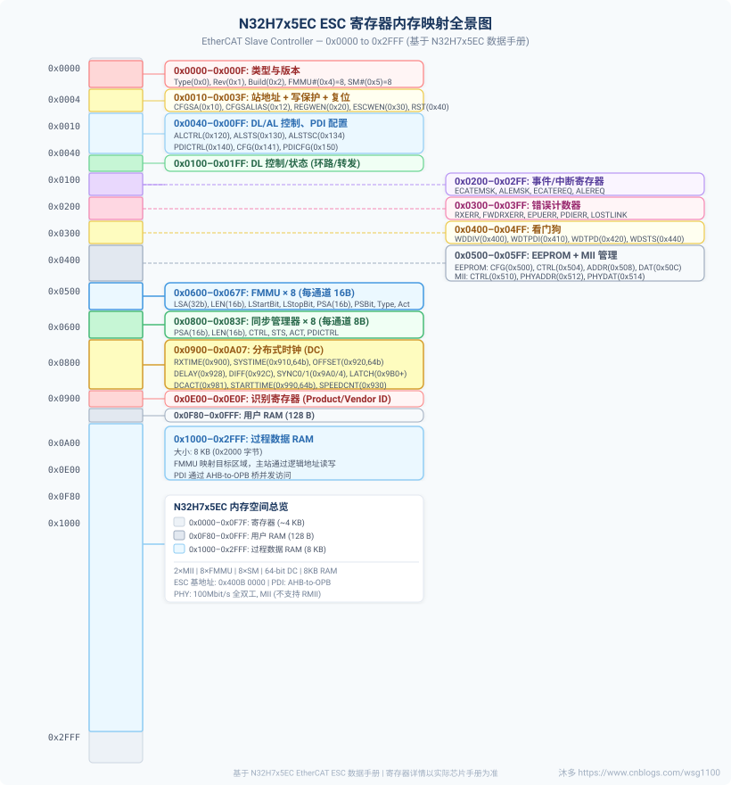

## 一、EtherCAT 协议概述

## 概览

### EtherCAT 是什么?

EtherCAT (Ethernet for Control Automation Technology) 是一种基于以太网的工业实时通信协议，由德国 **Beckhoff Automation** 公司于 2003 年开发。它已成为 IEC 61158 / IEC/PAS 62407 国际标准，是目前工业自动化领域中性能最高、应用最广泛的实时以太网协议之一。

> **核心理念："On the fly" 处理**
> 
> EtherCAT 的核心创新在于 **数据帧穿越从站时即时处理** ——从站 ESC (EtherCAT Slave Controller) 芯片在数据帧经过时直接读取或写入数据，无需接收完整帧后再处理。这使得 EtherCAT 具备极高的带宽利用率和超低通信延迟。

### 协议栈位置



*图：EtherCAT 与其他工业以太网协议在 OSI 模型中的对比*

### 核心优势

| 优势 | 说明 |
| --- | --- |
| 超低延迟 | 数据帧 "on the fly" 处理，周期可达 ~100μs，抖动 <1μs |
| 高带宽利用率 | 有效数据利用率超过 90%，远超传统以太网轮询机制 |
| 灵活拓扑 | 支持线型、星型、树型、环型拓扑，无需交换机 |
| 从站低成本 | ESC 芯片成本低廉，无需微处理器即可实现从站通信 |
| 精确同步 | 分布式时钟 (DC) 实现纳秒级全网时间同步 |
| 协议开放 | ETG (EtherCAT Technology Group) 维护，开放协议规范 |

### 与其他工业以太网协议对比

| 特性 | EtherCAT | PROFINET IRT | EtherNet/IP | POWERLINK |
| --- | --- | --- | --- | --- |
| 最小周期 | ~100 μs | ~31.25 μs | ~1 ms | ~200 μs |
| 时间抖动 | < 1 μs | < 1 μs | ~ms 级 | < 1 μs |
| 带宽利用率 | \> 90% | 高 | 低 | 中等 |
| 从站成本 | 低 (ESC 芯片) | 高 (需 ASIC) | 低 (标准以太网) | 中等 |
| 拓扑灵活性 | 线/星/树/环 | 星型为主 | 任意 | 线/星 |
| 同步精度 | 纳秒级 (DC) | 纳秒级 | 毫秒级 | 微秒级 |
| 标准 | IEC 61158 | IEC 61158 | IEC 61158 | IEC 61158 |

---

## 技术详情

### EtherCAT 通信原理

EtherCAT 基于标准以太网 (IEEE 802.3) 物理层，使用专有的 EtherType `0x88A4` 标识 EtherCAT 帧。与传统的 TCP/IP 通信不同，EtherCAT 直接在以太网帧中承载过程数据，完全跳过了 TCP/IP 协议栈，从而实现了极高的通信效率。

#### 帧处理流程


#### 核心协议组成

| 协议 | 全称 | 用途 |
| --- | --- | --- |
| CoE | CANopen over EtherCAT | SDO 参数配置、PDO 映射、Emergency 消息 |
| EoE | Ethernet over EtherCAT | 通过 EtherCAT 隧道传输标准以太网帧 |
| FoE | File Access over EtherCAT | 固件上传/下载 (类似 TFTP) |
| SoE | Servo over EtherCAT | 伺服驱动器参数访问 (SERCOS 映射) |
| VoE | Vendor-specific over EtherCAT | 厂商自定义协议扩展 |

### EtherCAT 从站状态机 (AL State Machine)

每个 EtherCAT 从站具有 4 个应用层状态（外加 1 个可选状态），由低到高：


| 状态 | 邮箱通信 | 过程数据 | 说明 |
| --- | --- | --- | --- |
| **Init** | 仅初始化 | 不可用 | 从站上电初始状态，ESC 寄存器可访问 |
| **Pre-Operational** | 可用 | 不可用 | 可通过邮箱 (CoE/SoE) 配置从站参数 |
| **Safe-Operational** | 可用 | 输入可读 | 过程数据输入可用，输出保持安全值 |
| **Operational** | 可用 | 读写可用 | 正常工作状态，过程数据完整交换 |
| **Bootstrap** （可选） | 可用 | 不可用 | 固件更新专用状态，由 Init 直接进入 |

---

## 深入源码

### IgH 中的协议实现概览

IgH EtherCAT Master 在内核空间完整实现了 EtherCAT 协议栈。以下列出协议各层对应的源码模块：

| 协议层          | 源文件                                     | 说明                       |
| ------------ | --------------------------------------- | ------------------------ |
| Datagram 收发  | `master/datagram.c`                     | Datagram 生命周期管理，14 种类型支持 |
| FMMU 配置      | `master/fmmu_config.c`                  | 逻辑地址到物理地址映射配置            |
| Sync Manager | `master/sync.c`, `master/sync_config.c` | 同步管理器/邮箱缓冲区配置            |
| 邮箱通信         | `master/mailbox.c`                      | 邮箱发送/接收/握手底层实现           |
| CoE (SDO)    | `master/fsm_coe.c`                      | SDO 上传/下载，字典读取，PDO 映射    |
| EoE          | `master/fsm_eoe.c`, `master/ethernet.c` | 以太网隧道，虚拟网络接口             |
| FoE          | `master/fsm_foe.c`                      | 文件传输/固件升级                |
| SoE          | `master/fsm_soe.c`                      | SERCOS 协议映射              |
| AL 状态转换      | `master/fsm_change.c`                   | 从站 AL 状态请求-确认机制          |
| DC 同步        | `master/fsm_slave_config.c` (DC 部分)     | 分布式时钟配置流程                |

> **源码阅读建议**
> 
> 建议按照以下顺序阅读协议相关源码：
> 
> 1. `datagram.h/c` — 理解数据帧基本单元
> 2. `mailbox.c` — 理解邮箱通信基础
> 3. `fsm_change.c` — 理解 AL 状态转换
> 4. `fsm_coe.c` — 理解 CoE/SDO 流程
> 5. 其他 FSM 按需深入

## 二、EtherCAT 数据帧结构

完整以太网帧 + EtherCAT Header + Datagram 结构详解

---

## 概览

### 帧结构全景

EtherCAT 数据帧基于标准 IEEE 802.3 以太网帧格式，使用 EtherType `0x88A4` 标识。在物理层上，完整帧包含 **帧间隔 (IFG, 12字节)** 、 **前导码 (Preamble, 7字节)** 、 **帧起始定界符 (SFD, 1字节)** 、以太网帧头、EtherCAT 数据区及 **FCS 帧校验 (4字节, CRC-32)** 。一个 EtherCAT 帧内可以 **串联多个 Datagram** ，每个 Datagram 独立寻址、独立处理。

> **100 Mbps 传输速率**
> 
> EtherCAT 物理层使用 100BASE-TX 全双工以太网 (100 Mbit/s)。在该速率下， **每传输一个字节需要 80 ns** （8 bits ÷ 100 MHz = 80 ns）。例如传输 100 字节数据需要 8 μs。



*图：完整的 EtherCAT 以太网帧字节级布局（含帧间隔、前导码、帧校验）*

#### 帧结构层次


---

## 技术详情

### 物理层帧结构与传输时序

EtherCAT 基于 IEEE 802.3 标准以太网，物理层使用 100BASE-TX 全双工模式，固定传输速率 100 Mbit/s。下面是以太网帧在物理线路上的完整结构：

| 字段                                 | 大小            | 说明                                                     | 传输时间 @ 100Mbps   |
| ---------------------------------- | ------------- | ------------------------------------------------------ | ---------------- |
| **IFG** (Inter-Frame Gap)          | 12 Bytes      | 帧间隔，以太网规范要求两帧之间的最小间隔，用于设备准备接收下一帧                       | 960 ns           |
| **Preamble** (前导码)                 | 7 Bytes       | 用于接收端时钟同步和信号电平稳定，固定模式 `0x55` (10101010) 重复 7 次         | 560 ns           |
| **SFD** (Start of Frame Delimiter) | 1 Byte        | 帧起始定界符，固定值 `0xD5` (10101011)，标记以太网帧的开始                 | 80 ns            |
| **Dest MAC** (目标地址)                | 6 Bytes       | 目标 MAC 地址                                              | 480 ns           |
| **Src MAC** (源地址)                  | 6 Bytes       | 源 MAC 地址                                               | 480 ns           |
| **EtherType**                      | 2 Bytes       | EtherCAT 固定值 `0x88A4` ，用于区分其他以太网协议                     | 160 ns           |
| **EtherCAT Data**                  | 44~1498 Bytes | 包含 EtherCAT Header (2B) + Datagram(s)，满足以太网最小帧 64 字节要求 | 3.52 ~ 119.84 μs |
| **FCS** (Frame Check Sequence)     | 4 Bytes       | 帧校验序列，使用 CRC-32 算法，覆盖 Dest MAC 到 Data 的全部内容，用于检测传输错误   | 320 ns           |

> **帧大小约束 (IEEE 802.3)**
> 
> **最小帧**: 以太网帧（不含 IFG 和前导码）最小 64 字节。当 EtherCAT 数据不足时需填充 (Padding) 到 46 字节载荷。  
> **最大帧**: 以太网帧（不含 IFG 和前导码）最大 1518 字节（标准帧）。  
> **完整帧**: 含 IFG + 前导码 + SFD + 以太网帧，最小 84 字节 (6.72 μs)，最大 1538 字节 (123.04 μs)。

### EtherCAT Header

| 字段 | 位数 | 说明 |
| --- | --- | --- |
| Length | 11 bits | EtherCAT 数据区长度 (不含 EtherCAT Header 本身) |
| Reserved | 1 bit | 保留位 |
| Type | 4 bits | 协议类型: 0x1 = EtherCAT Datagram 类型 |

### Datagram 结构详解

| 字段 | 大小 | 说明 |
| --- | --- | --- |
| **Cmd** | 1 Byte | 命令类型，决定操作方式 (读/写/读写) 和寻址模式 |
| **Index** | 1 Byte | Datagram 序号标识，由主站分配 |
| **Address** | 4 Bytes | 地址字段，含义取决于寻址模式 |
| **Len+M** | 2 Bytes | 数据区长度 (11 bits) + More 标志位 (1 bit，表示后续还有更多 Datagram) |
| **IRQ** | 2 Bytes | 中断寄存器，从站可通过此字段向主站发送中断请求 |
| **Data** | 最多 1486 Bytes | 有效数据负载 |
| **WKC** | 2 Bytes | Working Counter，由从站在处理过程中递增 |

### Datagram 命令类型一览

| 命令 | 代码 | 寻址模式 | 操作 | WKC 增量 |
| --- | --- | --- | --- | --- |
| **APRD** | 0x01 | Auto-increment | 读 | +1 (读) |
| **APWR** | 0x02 | Auto-increment | 写 | +2 (写) |
| **APRW** | 0x03 | Auto-increment | 读写 | +3 (读+写) |
| **FPRD** | 0x04 | Configured address | 读 | +1 |
| **FPWR** | 0x05 | Configured address | 写 | +2 |
| **FPRW** | 0x06 | Configured address | 读写 | +3 |
| **BRD** | 0x07 | Broadcast | 读 | 每站 +1 |
| **BWR** | 0x08 | Broadcast | 写 | 每站 +2 |
| **BRW** | 0x09 | Broadcast | 读写 | 每站 +3 |
| **LRD** | 0x0A | Logical | 读 | +1 |
| **LWR** | 0x0B | Logical | 写 | +2 |
| **LRW** | 0x0C | Logical | 读写 | +3 |
| **ARMW** | 0x0D | Auto-increment | 读多写 | +3 |
| **FRMW** | 0x0E | Configured address | 读多写 | +3 |

### 三种寻址模式


### WKC (Working Counter) 机制



*图：多个 Datagram 串联排列及 WKC 处理流程*

> **WKC 机制要点**
> 
> 每个从站处理 Datagram 时按操作类型递增 WKC：读操作 +1、写操作 +2、读写操作 +3。主站通过检查返回帧中的 WKC 值来验证操作是否被正确执行。若 WKC 不等于期望值，表示通信异常。

### 帧校验 (FCS / CRC-32)

FCS (Frame Check Sequence) 位于以太网帧末尾，长度为 4 字节，使用 CRC-32 多项式校验算法。FCS 覆盖范围从目标 MAC 地址到数据区末尾的全部内容（即以太网帧中除前导码和 FCS 本身之外的所有字段）。

> **FCS 与 ESC 处理**
> 
> ESC (EtherCAT 从站控制器) 在硬件层面自动处理 FCS：接收帧时验证 CRC-32，转发帧时重新计算并更新 FCS。这意味着 ESC 在 "on-the-fly" 处理过程中修改了帧数据（如写入过程数据、更新 WKC），FCS 会在转发时自动更新，无需主站干预。

---

## 深入源码

### 源码：master/datagram.h

#### ec\_datagram 结构体

master/datagram.h — ec\_datagram\_t 核心字段

```c
typedef struct {
    struct list_head queue;          // 主站 datagram 队列节点
    struct list_head sent;           // 已发送 datagram 列表节点
    ec_device_index_t device_index;  // 发送设备索引 (主/备)
    ec_datagram_type_t type;         // 命令类型 (APRD, APWR, ...)
    uint8_t address[EC_ADDR_LEN];   // 4 字节地址字段
    uint8_t *data;                   // 数据负载指针
    ec_origin_t data_origin;         // 数据内存来源 (内部/外部)
    size_t mem_size;                 // 数据内存大小
    size_t data_size;                // 实际数据大小
    uint8_t index;                   // Datagram 序号
    uint16_t working_counter;        // 工作计数器 (返回值)
    ec_datagram_state_t state;       // 当前状态
    unsigned long jiffies_sent;      // 发送时间戳
    unsigned long jiffies_received;  // 接收时间戳
    char name[EC_DATAGRAM_NAME_SIZE];// Datagram 描述名
} ec_datagram_t;
```

#### Datagram 类型枚举

master/datagram.h — ec\_datagram\_type\_t

```c
typedef enum {
    EC_DATAGRAM_NONE = 0x00,  // 空类型
    EC_DATAGRAM_APRD = 0x01,  // Auto-increment Physical Read
    EC_DATAGRAM_APWR = 0x02,  // Auto-increment Physical Write
    EC_DATAGRAM_APRW = 0x03,  // Auto-increment Physical ReadWrite
    EC_DATAGRAM_FPRD = 0x04,  // Configured Address Physical Read
    EC_DATAGRAM_FPWR = 0x05,  // Configured Address Physical Write
    EC_DATAGRAM_FPRW = 0x06,  // Configured Address Physical ReadWrite
    EC_DATAGRAM_BRD  = 0x07,  // Broadcast Read
    EC_DATAGRAM_BWR  = 0x08,  // Broadcast Write
    EC_DATAGRAM_BRW  = 0x09,  // Broadcast ReadWrite
    EC_DATAGRAM_LRD  = 0x0A,  // Logical Read
    EC_DATAGRAM_LWR  = 0x0B,  // Logical Write
    EC_DATAGRAM_LRW  = 0x0C,  // Logical ReadWrite
    EC_DATAGRAM_ARMW = 0x0D,  // Auto-increment Read Multiple Write
    EC_DATAGRAM_FRMW = 0x0E   // Configured Address Read Multiple Write
} ec_datagram_type_t;
```

#### Datagram 状态枚举

master/datagram.h — ec\_datagram\_state\_t

```c
typedef enum {
    EC_DATAGRAM_INIT,       // 初始化状态
    EC_DATAGRAM_QUEUED,     // 已入队等待发送
    EC_DATAGRAM_SENT,       // 已发送 (仍在队列中)
    EC_DATAGRAM_RECEIVED,   // 已接收 (已出队)
    EC_DATAGRAM_TIMED_OUT,  // 超时 (已出队)
    EC_DATAGRAM_ERROR,      // 发送/接收错误
    EC_DATAGRAM_INVALID     // 无效，不应被入队
} ec_datagram_state_t;
```

### 源码：master/datagram.c 关键函数

| 函数 | 说明 |
| --- | --- |
| `ec_datagram_aprd(datagram, ring_pos, addr, size)` | 构造 Auto-increment 读 Datagram |
| `ec_datagram_fpwr(datagram, config_addr, addr, size)` | 构造 Configured address 写 Datagram |
| `ec_datagram_lrd(datagram, offset, size)` | 构造逻辑地址读 Datagram |
| `ec_datagram_lrw(datagram, offset, size)` | 构造逻辑地址读写 Datagram |
| `ec_datagram_brd(datagram, addr, size)` | 构造广播读 Datagram |
| `ec_datagram_print_wc_error(datagram)` | 打印 WKC 错误信息 |

> **常量定义**
> 
> `EC_ADDR_LEN = 4` — 地址字段长度  
> `EC_DATAGRAM_HEADER_SIZE = 10` — Datagram 头部长度 (Cmd+Idx+Addr+Len+IRQ)  
> `EC_DATAGRAM_FOOTER_SIZE = 2` — Datagram 尾部长度 (WKC)  
> `EC_MAX_DATA_SIZE ≈ 1486` — 单个 Datagram 最大数据长度

## 三、ESC 从站控制器 (EtherCAT Slave Controller)

1.3 — ESC 硬件实现、寄存器映射、帧处理流程（基于 N32H7x5EC）

---

## 概览

### ESC 是什么?

ESC (EtherCAT Slave Controller) 是 EtherCAT 从站的 **核心通信芯片** ，负责处理 EtherCAT 数据帧。ESC 由德国 Beckhoff 授权的 IP 核实现，在数据帧经过时直接读取/写入过程数据，无需在每个节点接收、解析和复制数据，实现 "on the fly" 帧处理。

> **N32H7x5EC ESC 主要特性**
> 
> **MII 端口**: 2 个（连接外部以太网 PHY）  
> **FMMU**: 8 个现场总线内存管理单元  
> **同步管理器 (SM)**: 8 个  
> **过程数据内存**: 8 KB  
> **分布式时钟 (DC)**: 64 位纳秒精度  
> **过程数据接口 (PDI)**: 片上总线（AHB-to-OPB 桥接）

### ESC 内部功能模块


### ESC 内存映射全景



*图：N32H7x5EC ESC 内存映射 (0x0000–0x2FFF)*

---

## 技术详情

### ESC 帧处理流程

ESC 使用标准 IEEE 802.3 以太网帧，EtherType = `0x88A4` 。ESC 无 MAC/IP 地址，可处理任意 MAC/IP 的 EtherCAT 帧。帧处理顺序：端口 0 → EPU → 端口 1。帧不存储，通过时即读写，转发延迟最小化。


#### 环路控制

每个端口可处于打开或关闭状态，支持四种环路控制模式：

| 模式 | 描述 |
| --- | --- |
| 手动打开 | 端口始终开启，即使无链路 |
| 手动关闭 | 端口始终关闭 |
| 自动 | 根据链路状态自动开关 |
| 自动关闭 | 链路丢失时关闭，但不自动打开 |

> **⚠ 注意**
> 
> 若所有端口均关闭，端口 0 自动打开作为恢复端口。ESC 间或主站与首个从站间不能使用非管理型交换机。

#### 影子缓冲区

寄存器写入（0x0000-0x0F7F）先存入影子缓冲区，帧 FCS 正确后才写入有效寄存器。过程数据 RAM 无影子缓冲区。

#### 循环帧防护

端口 0 环路关闭且为自动模式时，EPU 设置数据报循环位 (C 位)。循环位已为 1 的帧被丢弃，防止帧在网络中无限循环。

### ESC 寄存器映射表

| 地址范围 | 大小 | 区域名称 | 读/写 | 说明 |
| --- | --- | --- | --- | --- |
| 0x0000–0x000F | 16 B | 类型与版本信息 | R | ESC 类型 (0xAC/0xAD)、版本号、构建号、FMMU/SM 数量、端口描述 |
| 0x0010–0x0011 | 2 B | 配置站地址 | R/W | ESC\_CFGSA — 用于 FPRD/FPWR 寻址 |
| 0x0012–0x0013 | 2 B | 配置站别名 | R/W | ESC\_CFGSALIAS |
| 0x0020 | 1 B | 寄存器写使能 | W | ESC\_REGWEN — 写保护控制 |
| 0x0030 | 1 B | ESC 写使能 | W | ESC\_ESCWEN — 全局写保护控制 |
| 0x0040 | 1 B | ECAT 复位 ESC | W | 连续写入 'R','E','S' 触发硬件复位 |
| 0x0041 | 1 B | PDI 复位 ESC | W | ESC\_RSTPDI |
| 0x0100–0x0103 | 4 B | DL 控制 | R/W | ESC\_DLCTRL — 环路控制/FIFO/转发设置 |
| 0x0108–0x010B | 4 B | 物理 R/W 偏移 | R/W | ESC\_RWOFFSET |
| 0x0110–0x0111 | 2 B | DL 状态 | R | ESC\_DLSTS |
| 0x0120–0x0121 | 2 B | AL 控制 | R/W | ESC\_ALCTRL — 应用层状态控制 |
| 0x0130–0x0131 | 2 B | AL 状态 | R | ESC\_ALSTS — 当前应用层状态 |
| 0x0134–0x0135 | 2 B | AL 状态码 | R | ESC\_ALSTSC — 状态码/错误码 |
| 0x0140–0x0159 | ~26 B | PDI 控制/配置 | R/W | ESC\_PDICTRL, ESC\_CFG, ESC\_PDIINFO, ESC\_PDICFG 等 |
| 0x0200–0x0223 | ~36 B | 事件/中断寄存器 | R/W | ECAT 事件屏蔽/请求, AL 事件屏蔽/请求 |
| 0x0300–0x0317 | ~24 B | 错误计数器 | R/W | RX 错误、转发错误、EPU 错误、丢失链接计数器 |
| 0x0400–0x0445 | ~70 B | 看门狗寄存器 | R/W | 分频器、PDI/PD 看门狗时间、状态、计数器 |
| 0x0500–0x051F | ~32 B | EEPROM 寄存器 | R/W | 配置、控制/状态、地址、数据 |
| 0x0510–0x0519 | ~10 B | MII 管理寄存器 | R/W | PHY 管理接口控制、地址、数据 |
| 0x0600–0x067F | 128 B | FMMU 寄存器 | R/W | 8 个 FMMU 通道，每个 16 字节 (0x0600+0x10×n) |
| 0x0800–0x083F | 64 B | 同步管理器寄存器 | R/W | 8 个 SM 通道，每个 8 字节 (0x0800+0x08×n) |
| 0x0900–0x0A07 | ~264 B | 分布式时钟 (DC) 寄存器 | R/W | 接收时间、系统时间、偏移、延迟、SYNC 控制、Latch 等 |
| 0x0E00–0x0E0F | 16 B | 识别寄存器 | R | 产品 ID、供应商 ID（来自 EEPROM） |

### ESC 内存空间总览

| 地址范围 | 大小 | 用途 |
| --- | --- | --- |
| 0x0000–0x0F7F | ~4 KB | 寄存器 |
| 0x0F80–0x0FFF | 128 B | 用户 RAM |
| 0x1000–0x2FFF | 8 KB | 过程数据 RAM |

### FMMU 寄存器配置（每个通道 16 字节）

偏移地址公式： `0x0600 + 0x10 × n` （n = 0~7）

| 偏移 | 寄存器名 | 大小 | 说明 |
| --- | --- | --- | --- |
| +0x00 | ESC\_FMMUnLSA | 4 B | 逻辑起始地址 (32 位) |
| +0x04 | ESC\_FMMUnLEN | 2 B | 长度 (16 位) |
| +0x06 | ESC\_FMMUnLSATB | 1 B | 逻辑起始位 |
| +0x07 | ESC\_FMMUnLSTPB | 1 B | 逻辑停止位 |
| +0x08 | ESC\_FMMUnPSA | 2 B | 物理起始地址 (16 位) |
| +0x0A | ESC\_FMMUnPSATB | 1 B | 物理起始位 |
| +0x0B | ESC\_FMMUnTYPE | 1 B | 类型 (读/写/读写) |
| +0x0C | ESC\_FMMUnACT | 1 B | 激活/停用 |

### 同步管理器寄存器（每个通道 8 字节）

偏移地址公式： `0x0800 + 0x08 × n` （n = 0~7）

| 偏移 | 寄存器名 | 大小 | 说明 |
| --- | --- | --- | --- |
| +0x00 | ESC\_SMnPSA | 2 B | 物理起始地址 |
| +0x02 | ESC\_SMnLEN | 2 B | 长度 |
| +0x04 | ESC\_SMnCTRL | 1 B | 控制 (模式/方向/看门狗/中断) |
| +0x05 | ESC\_SMnSTS | 1 B | 状态 |
| +0x06 | ESC\_SMnACT | 1 B | 激活 |
| +0x07 | ESC\_SMnPDICTRL | 1 B | PDI 控制 |

### 同步管理器通信模式

| 模式 | 特点 | 用途 |
| --- | --- | --- |
| 缓冲模式（三缓冲） | 生产者可随时写入，消费者获取最新数据，旧数据丢弃 | 周期过程数据 |
| 邮箱模式 | 握手机制，交替读写，数据不丢失 | 应用层协议（EoE/CoE/FoE/AoE） |

### 错误计数器

所有计数器在 0xFF 饱和，可通过写入清除。

| 计数器 | 寄存器 | 描述 |
| --- | --- | --- |
| 无效帧计数器 | ESC\_RXERRCNTn (低 8 位) | 最初检测到无效帧 |
| RX 错误计数器 | ESC\_RXERRCNTn (高 8 位) | 物理层接收错误 |
| 转发 RX 错误计数器 | ESC\_FWDRXERRCNTn | 前级 ESC 标记的无效帧 |
| EPU 错误计数器 | ESC\_EPUERRCNT | 无效帧通过 EPU |
| PDI 错误计数器 | ESC\_PDIERRCNT | PDI 检测到的物理错误 |
| 丢失链接计数器 | ESC\_LOSTLINKCNTn | 链路丢失事件（每端口） |
| 看门狗计数器 PD | ESC\_WDCNTPD | 过程数据看门狗超时 |
| 看门狗计数器 PDI | ESC\_WDCNTPDI | PDI 看门狗超时 |

### 看门狗

两个独立看门狗共享分频器：

| 看门狗 | 触发条件 | 超时后果 |
| --- | --- | --- |
| 过程数据 WD | SM 缓冲区完整写入 | 状态位反映，计数器递增 |
| PDI WD | 任何 PDI 读写访问 | DL 状态位反映，计数器递增 |

超时计算： `tWD_Div = (WD_DIV + 2) × 40 ns` 。过程数据/PDI 看门狗分别可通过将对应时间寄存器设为 0 来禁用。

### 写保护机制

| 保护类型 | 范围 | 说明 |
| --- | --- | --- |
| 寄存器写保护 | 0x0000–0x0F7F | 需在帧内先写 ESC\_REGWEN (0x0020) |
| ESC 写保护 | 所有区域 | 需在帧内先写 ESC\_ESCWEN (0x0030) |

### ESC 复位

通过 ECAT 或 PDI 向 0x0040/0x0041 连续写入 `0x52('R')` 、 `0x45('E')` 、 `0x53('S')` 触发硬件复位。复位信号可通过 GPIO 输出（如 PHY 复位）。

### LED 信号状态

| LED | 状态 | 含义 |
| --- | --- | --- |
| RUN LED (绿) | 灭 | INIT 状态 |
| 慢闪 | 预运行 (Pre-Op) 状态 |  |
| 单闪 | 安全运行 (Safe-Op) 状态 |  |
| 常亮 | 运行 (Op) 状态 |  |
| 快闪 | BOOTSTRAP 或加载 EEPROM |  |
| ERR LED (红) | 灭 | 无错误 |
| 快闪 | EEPROM 加载错误 |  |
| 慢闪 | 无效硬件配置 |  |
| 单闪 | AL 状态错误指示 |  |
| 双闪 | 过程数据看门狗超时 |  |
| 常亮 | PDI 看门狗超时或自检错误 |  |

### ESC 封装器寄存器 (N32H7x5EC 特有)

ESC 起始地址： `0x400B 0000` 。封装器提供额外的控制和配置寄存器：

| 偏移地址 | 寄存器 | 描述 |
| --- | --- | --- |
| 0x0000 | ESC\_WRACTRLSTS | 控制状态（含 ESCRST 位） |
| 0x0004 | ESC\_WRACFG0 | 配置 0（TXSHIFT, LINKPOL, ADDROFFSET 等） |
| 0x0008 | ESC\_WRACFG1 | 配置 1（EEPROMSIZE, 中断使能, RSTESC 等） |
| 0x000C | ESC\_WRAINTSTS | 中断状态（SYNC\_OUT, PDI\_WD, RESET, SOF/EOF 等） |

### 中断机制

#### AL 事件请求（PDI 中断）

AL 事件请求寄存器与 AL 事件屏蔽寄存器逻辑与后，所有位逻辑或合并为一个 IRQ。

| 中断线 | NVIC 映射 | 说明 |
| --- | --- | --- |
| IRQ\_A | ECAT\_OPB\_IRQ | AL 事件合并中断 |
| IRQ\_B | ECAT\_SYNC0\_INT | DC SYNC0 中断 |
| IRQ\_C | ECAT\_SYNC1\_INT | DC SYNC1 中断 |
| IRQ\_D | ECAT\_WRP\_INT | 封装器中断 |

#### ECAT 事件请求（ECAT 中断）

通知主站从站事件，利用 EtherCAT 数据报中的 IRQ 字段，各从站中断位逻辑或组合。

### SII EEPROM

通过 I2C 接口连接外部 EEPROM（最大 1 Mbit），EEPROM\_CLK 和 EEPROM\_DATA 需 4.7kΩ 上拉电阻。半字（16 位）寻址。

#### EEPROM 内容布局

| 半字地址 | 内容 |
| --- | --- |
| 0x0 | PDI 控制/ESC 配置 |
| 0x1 | PDI 配置 |
| 0x2 | 同步信号脉冲长度 |
| 0x3 | 扩展 PDI 配置 |
| 0x4 | 配置站别名 |
| 0x7 | 校验和 |
| 0x8–0x9 | 供应商 ID |
| 0xA–0xB | 产品代码 |
| 0xC–0xD | 修订编号 |
| 0xE–0xF | 序列号 |
| 0x14–0x1B | 邮箱配置（偏移/大小） |
| 0x1C | 邮箱协议 |
| 0x28–0x2F | 额外 ESC 配置 |
| 0x3E | 大小 |
| 0x3F | 版本 |
| 0x40+ | 类别数据 (Category) |

支持三种 EEPROM 命令：读（4 字节）、写（2 字节）、重新加载。上电/复位后自动加载配置区域（半字 0-7）。写操作需先在同一帧内设置写使能位。

### 物理层要求

100 Mbit/s 全双工，使用标准 IEEE 802.3 PHY，通过 MII 接口连接。 **不支持 RMII** （会增加转发延迟和抖动）。

三种链路状态来源：LINK\_MII 信号（PHY LED 输出，最快）→ MI 链路检测（MII 管理接口轮询）→ 增强型链路检测（RX\_ERR 信号检测）。

### EtherCAT 命令类型

| CMD | 缩写 | 名称 | 描述 |
| --- | --- | --- | --- |
| 0 | NOP | 无操作 | 从站忽略命令 |
| 1 | APRD | 自动递增读 | 地址递减，为 0 时读取数据 |
| 2 | APWR | 自动递增写 | 地址递减，为 0 时写入数据 |
| 3 | APRW | 自动递增读写 | 地址递减，为 0 时读写数据 |
| 4 | FPRD | 配置地址读 | 地址匹配时读取 |
| 5 | FPWR | 配置地址写 | 地址匹配时写入 |
| 6 | FPRW | 配置地址读写 | 地址匹配时读写 |
| 7 | BRD | 广播读 | 所有从站逻辑或读取 |
| 8 | BWR | 广播写 | 所有从站写入 |
| 9 | BRW | 广播读写 | 所有从站逻辑或读写 |
| 10 | LRD | 逻辑内存读 | FMMU 读映射 |
| 11 | LWR | 逻辑内存写 | FMMU 写映射 |
| 12 | LRW | 逻辑内存读写 | FMMU 读写映射 |
| 13 | ARMW | 自动递增读多次写 | 自动递增读，多次写 |
| 14 | FRMW | 配置读多次写 | 配置地址匹配读，多次写 |

### WKC (工作计数器)

每次成功读写操作递增 WKC：读操作 +1，写操作 +2，读写操作 +3。

---

## 深入源码

### 源码：master/slave.h — ec\_slave 结构体

从站在 IgH 主站中由 `ec_slave` 结构体表示，包含了从 ESC 寄存器和 EEPROM/SII 中读取的所有信息：

master/slave.h — ec\_slave 关键字段

```c
struct ec_slave {
    ec_master_t *master;             // 所属主站
    ec_device_index_t device_index;  // 响应设备索引 (主/备网卡)

    // 地址信息
    uint16_t ring_position;          // 环形拓扑位置
    uint16_t station_address;        // 配置站地址 (对应 ESC 0x0010)
    uint16_t effective_alias;        // 有效别名地址 (对应 ESC 0x0012)

    // 端口信息
    ec_slave_port_t ports[EC_MAX_PORTS]; // 端口状态
    uint8_t upstream_port;           // 面向主站的端口索引

    // 配置状态
    ec_slave_config_t *config;       // 当前从站配置
    ec_slave_state_t requested_state;// 请求的 AL 状态 (写 0x0120)
    ec_slave_state_t current_state;  // 当前 AL 状态 (读 0x0130)
    uint16_t last_al_error;          // 最后 AL 错误码 (读 0x0134)

    // 邮箱配置 (来自 EEPROM 0x14-0x1B)
    uint16_t configured_rx_mailbox_offset;
    uint16_t configured_rx_mailbox_size;
    uint16_t configured_tx_mailbox_offset;
    uint16_t configured_tx_mailbox_size;

    // 基础信息 (从 ESC 0x0000 区域读取)
    uint8_t base_type;               // ESC 类型 (0x0000, 复位值 0xAC/0xAD)
    uint8_t base_revision;           // ESC 修订版本 (0x0001)
    uint16_t base_build;             // 构建版本 (0x0002-0x0003)
    uint8_t base_fmmu_count;         // FMMU 数量 (0x0004, 复位值 0x08)
    uint8_t base_sync_count;         // SM 数量 (0x0005, 复位值 0x08)
    uint8_t base_dc_supported;       // 是否支持 DC (0x0008 特性位)
    ec_slave_dc_range_t base_dc_range; // DC 范围类型
    uint32_t transmission_delay;     // DC 传播延迟 (写入 0x0928)

    // SII/EEPROM 数据
    uint16_t *vendor_words;          // SII 前 16 个字
    ec_sii_image_t *sii_image;       // 完整 SII 镜像

    // 各类请求队列
    struct list_head sdo_requests;   // SDO 请求队列
    struct list_head foe_requests;   // FoE 请求队列
    struct list_head soe_requests;   // SoE 请求队列
    struct list_head eoe_requests;   // EoE 请求队列

    // 邮箱接收数据缓冲区
    ec_mbox_data_t mbox_coe_data;
    ec_mbox_data_t mbox_foe_data;
    ec_mbox_data_t mbox_soe_data;
    ec_mbox_data_t mbox_voe_data;
};
```

### ESC 寄存器访问方式

IgH 主站通过以下 Datagram 类型访问 ESC 寄存器：

| 场景 | Datagram 类型 | 用途 |
| --- | --- | --- |
| 拓扑扫描 | APRD (Auto-increment Read) | 扫描时按递增地址读取各从站 ESC 寄存器（类型/版本 0x0000） |
| 正常运行 | FPRD/FPWR (Configured address) | 通过配置站地址 (0x0010) 读写从站寄存器 |
| 过程数据 | LRD/LWR/LRW (Logical) | 通过 FMMU (0x0600+) 逻辑地址映射访问过程数据 RAM (0x1000-0x2FFF) |
| 广播操作 | BRD/BWR (Broadcast) | 同时向所有从站读写 (如 DC 时间同步 0x0910) |
| DC 漂移补偿 | ARMW/FRMW | 读取参考时钟并写入其他从站 (0x0910) |

#### 深入了解

- [分布式时钟 (DC)](https://www.cnblogs.com/wsg1100/p/dc.md) — DC 寄存器详解与时间同步机制
- [FMMU 原理](https://www.cnblogs.com/wsg1100/p/fmmu.md) — FMMU 逻辑地址到物理地址的映射机制
- [同步管理器](https://www.cnblogs.com/wsg1100/p/sync-manager.md) — SM 缓冲区管理与通信模式
- [AL 状态机](https://www.cnblogs.com/wsg1100/p/al-state-machine.md) — ESC 状态机转换机制 (0x0120/0x0130)
- [EEPROM 处理](https://www.cnblogs.com/wsg1100/modules/eeprom.md) — SII EEPROM 读取解析流程

#### 深入了解

- [ESC 从站控制器](https://www.cnblogs.com/wsg1100/p/esc.md) — ESC 寄存器全景与帧处理流程
- [FMMU 原理](https://www.cnblogs.com/wsg1100/p/fmmu.md) — 过程数据如何通过 FMMU 映射到逻辑地址
- [同步管理器](https://www.cnblogs.com/wsg1100/p/sync-manager.md) — SM 缓冲区管理与通信模式
- [Slave Config FSM](https://www.cnblogs.com/wsg1100/modules/fsm-slave-config.md) — DC 配置状态机在从站配置流程中的位置
- [启动配置流程](https://www.cnblogs.com/wsg1100/workflows/startup-flow.md) — DC 同步在整体启动序列中的时序

本文版权归作者和博客园共有，欢迎转载，但必须给出原文链接，并保留此段声明，否则保留追究法律责任的权利。